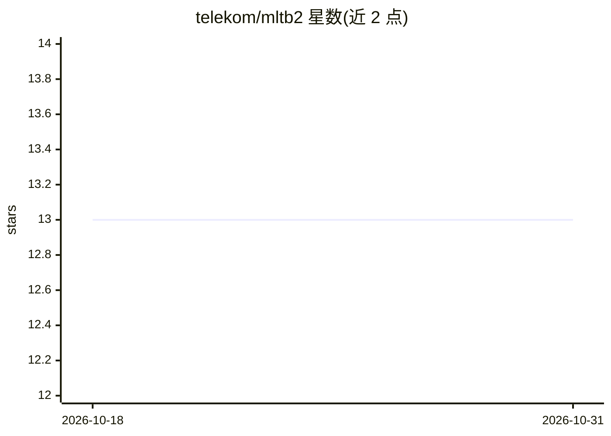

# telekom/mltb2

⭐ 13 · Python · MIT · 推送 2025-11-22 · [GitHub](https://github.com/telekom/mltb2) · [官网](https://telekom.github.io/mltb2/) · 组织维护

**机器学习工具箱 Python 库，提供模块化 ML 工具集合**

由 Deutsche Telekom 维护的开源 Python 库（mltb2），以模块化形式提供一系列机器学习相关工具，主题涉及深度学习、超参数优化、NLP 与 LLM。通过 PyPI 以 pip 安装；多数模块需要按模块文档另行安装可选依赖。采用 MIT 许可， copyrights 归属个人与 Deutsche Telekom AG 的多位贡献者，项目配文档页、pytest 测试与静态代码检查等 CI 徽章。README 本身未列出具体模块功能细节。

## 筛选速览

| 维度 | 判定 | 备注 |
|---|---|---|
| AI 角色 | `ai-ecosystem` | LLM/agent 周边工具 |
| 许可风险 | `permissive` | MIT |
| 部署形态 | `library` | 以包/库形式分发 |
| 模型依赖 | — | README 未给出锁定关系 |
| 硬件要求 | — | 无带数字的原话,不猜 |
| 安装摩擦 | `low` | 无编译、无系统依赖或容器化 |
| 成熟度 | — | 结构信号不足 |

## 能力要点

- Python 包形式的模块化机器学习工具集合（pip install mltb2）
- 多数模块依赖可选依赖，需按模块文档单独安装
- MIT 许可，包含文档页与测试/静态检查 CI 配置

## 适用场景

- 在 ML/NLP/LLM 项目中按需引入具体工具模块
- 开发者通过文档页查找并组合所需 ML 工具

## 场景标签

 · 领域:机器学习/工具库

## 证据(README 行号)

> L13: 📦 A box full of machine learning tools. 📦
> L27: For many modules optional dependencies are necessary.

## 星数曲线

2026-10-18 13 → 2026-10-31 13（+0）

---
*卡片 v1 · prompt 1.4 · 生成 2026-10-31 · 置信度 low · 依据 README sha `31a683e0f353` · [字段定义](../../DATASET.md)*
