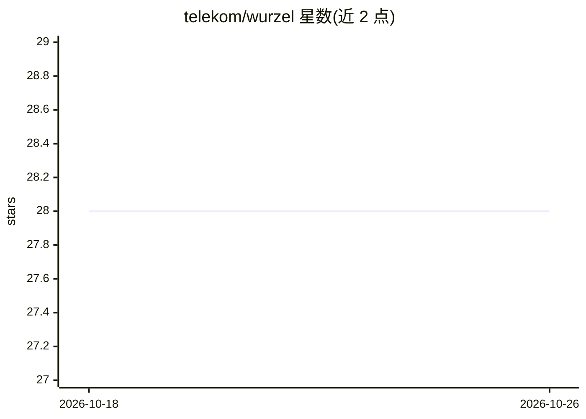

# telekom/wurzel

⭐ 28 · Python · CC0-1.0 · 推送 2026-09-16 · [GitHub](https://github.com/telekom/wurzel) · [官网](https://telekom.github.io/wurzel/) · 组织维护

**面向 RAG 系统的 Python ETL 管道框架**

由 Telekom 开源的 Python 库，用于构建 RAG 系统的 Extract/Transform/Load 管道：以可独立运行的 step 为单位（CLI 或 Python 代码执行），内置多租户管理、云原生部署支持（Kubernetes/Docker）与任务调度能力。预置 Qdrant、Milvus、Hugging Face 等常用框架的初始实现，并借助 pydantic 与 pandera 提供类型安全。通过 pip 安装，面向构建可扩展 RAG 管道集成的开发者。

## 筛选速览

| 维度 | 判定 | 备注 |
|---|---|---|
| AI 角色 | `ai-ecosystem` | LLM/agent 周边工具 |
| 许可风险 | `viral` | CC0-1.0 |
| 部署形态 | `library` | 以包/库形式分发 |
| 模型依赖 | — | README 未给出锁定关系 |
| 硬件要求 | — | 无带数字的原话,不猜 |
| 安装摩擦 | `low` | 无编译、无系统依赖或容器化 |
| 成熟度 | — | 结构信号不足 |

## 能力要点

- 面向 RAG 需求的 ETL 管道框架
- step 可通过 CLI 或 Python 两种方式运行
- 预置 Qdrant、Milvus、Hugging Face 集成实现
- 基于 pydantic 与 pandera 的类型安全

## 适用场景

- 为 RAG 系统搭建文档抽取与加载管道
- 在多租户环境下管理多条 RAG 管道
- 在 Kubernetes/Docker 环境部署与调度 ETL 任务

## 场景标签

 · 领域:LLM 基础设施/RAG 数据管道

## 证据(README 行号)

> L11: wurzel is an open-source Python library built to address advanced **Extract, Transform, Load (ETL)** needs for **Re
> L13: The repository includes initial implementations for widely-used frameworks in the RAG ecosystem, such as Qdrant, Mi

## 星数曲线

2026-10-18 28 → 2026-10-26 28（+0）

---
*卡片 v1 · prompt 1.4 · 生成 2026-10-26 · 置信度 high · 依据 README sha `2c1ed0bc85db` · [字段定义](../../DATASET.md)*
