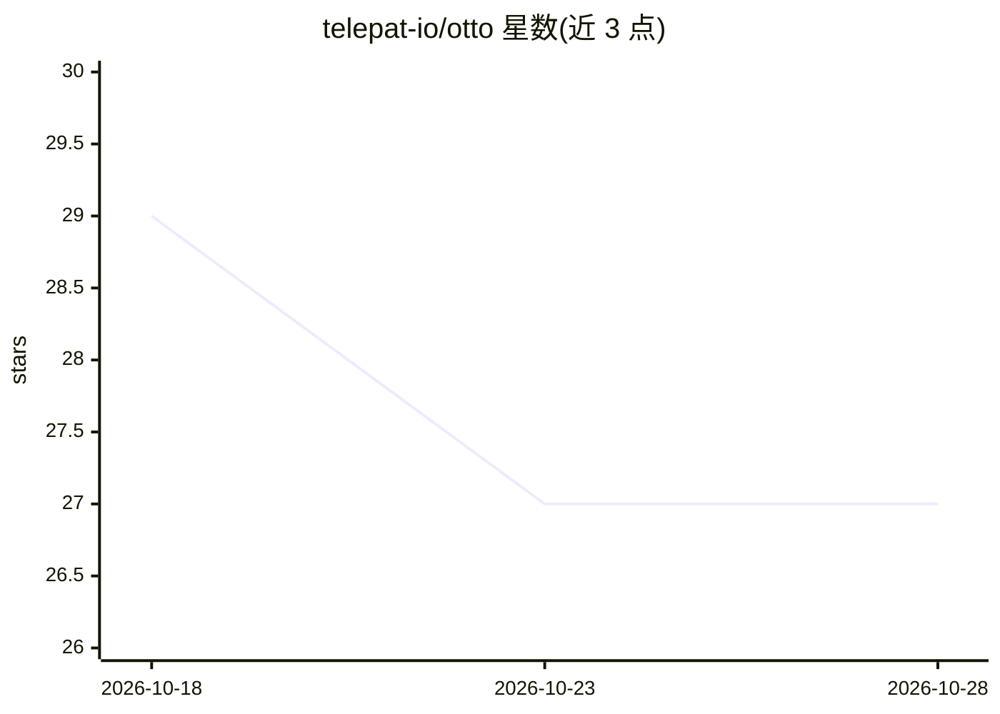

# telepat-io/otto

⭐ 27 · TypeScript · 推送 2026-06-25 · [GitHub](https://github.com/telepat-io/otto) · [官网](http://docs.telepat.io/otto/) · 组织维护 · 中文 README

**面向开发者的真实浏览器远程自动化平台，供 agent 调用**

通过 WebSocket 将 CLI/脚本命令经 relay 守护进程路由到 Chrome 扩展，在真实浏览器标签页上执行点击、输入、导航与 DOM 提取，无需自建无头浏览器集群。确定性代码处理交互，LLM/agent 仅负责决策，并支持 MCP server、--json 输出与非交互式 setup。内置 Reddit/LinkedIn/HN/Google 站点命令与 markdown/HTML 提取原语，token 认证、重放保护与节点 ACL。要求 Node.js 20+ 与 Chrome，支持 macOS/Linux/Windows。

## 筛选速览

| 维度 | 判定 | 备注 |
|---|---|---|
| AI 角色 | `ai-ecosystem` | LLM/agent 周边工具 |
| 许可风险 | `none` | — |
| 部署形态 | `library` | 以包/库形式分发 |
| 模型依赖 | — | README 未给出锁定关系 |
| 硬件要求 | — | 无带数字的原话,不猜 |
| 安装摩擦 | `low` | 无编译、无系统依赖或容器化 |
| 成熟度 | — | 结构信号不足 |

## 能力要点

- CLI/脚本经 relay 控制 Chrome 扩展在真实标签页执行命令
- MCP server、--json 输出与非交互式 setup，面向 agent 与 CI
- Reddit/LinkedIn/HN/Google 站点命令及 markdown/HTML 提取原语
- token 认证、重放保护、节点 ACL 与日志脱敏

## 适用场景

- 让 agent 或 CI 在真实浏览器上执行自动化工作流
- 从 Reddit/LinkedIn 等站点提取内容用于监控或数据抽取
- 在远程主机浏览器上运行测试与调试并流式查看日志

## 场景标签

`浏览器自动化` `网页抓取` · 领域:效率与自动化

## 证据(README 行号)

> L23: - **Code drives the browser. The LLM just decides what to do.** — Otto handles clicks, typing, navigation, and DOM 
> L28: - **Agent and CI ready** — Non-interactive setup, `--json` output, MCP server, streaming test harness, and agent ru
> L129: ## Using With AI Agents

## 星数曲线

2026-10-18 29 → 2026-10-28 27（-2）

---
*卡片 v1 · prompt 1.4 · 生成 2026-10-26 · 置信度 high · 依据 README sha `681b3e37926b` · [字段定义](../../DATASET.md)*
