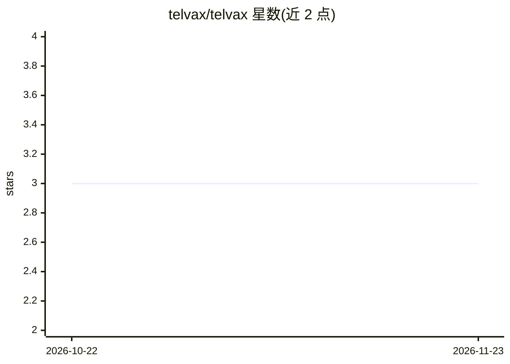

# telvax/telvax

⭐ 3 · Rust · Apache-2.0 · 推送 2026-11-22 · [GitHub](https://github.com/telvax/telvax) · [官网](https://telvax.github.io/telvax/) · 组织维护

**面向数据、ML 流水线与 AI 服务的静态类型编译语言**

一种静态类型、可编译的编程语言，程序写在 .tvx 文件中由 telvax 命令运行，语法接近 Python。类型系统内含张量形状（形状不匹配在编译期报错），表类型基于 Arrow 并支持 SQL 与 CSV/Parquet 读取，标记 @endpoint 的函数生成带校验的 HTTP 路由。工具链包含解释器与基于 MLIR/LLVM 的原生后端、LSP、REPL、包管理器 tvpm、Jupyter kernel。README 标注为 early alpha，标准库与工具可能变动，Windows 尚无原生后端。

## 筛选速览

| 维度 | 判定 | 备注 |
|---|---|---|
| AI 角色 | `ai-ecosystem` | LLM/agent 周边工具 |
| 许可风险 | `permissive` | Apache-2.0 |
| 部署形态 | `self-host` | docker 或自建部署 |
| 模型依赖 | local-ok | 支持本地模型 |
| 硬件要求 | — | 无带数字的原话,不猜 |
| 安装摩擦 | `low` | 无编译、无系统依赖或容器化 |
| 成熟度 | `idea` | |

## 能力要点

- 张量形状作为类型的一部分，matmul 形状不匹配为编译错误
- @endpoint 函数自动生成带校验的 JSON HTTP 路由，可产出单一二进制与 Dockerfile
- Table[Row] 基于 Arrow，读取 CSV/Parquet 并运行 SQL
- 附带解释器与 MLIR/LLVM 原生后端、StableHLO/PTX 生成器

## 适用场景

- 对 CSV/Parquet 数据做带类型列的汇总与 SQL 查询
- 在运行前用类型系统检查模型张量形状
- 把函数直接发布为带校验的 JSON HTTP 服务
- 搭建包含嵌入、向量检索与 LLM 的 RAG 服务

## 场景标签

 · 领域:编程语言/开发工具

## 证据(README 行号)

> L7: A statically typed, compiled language for data, ML pipelines and AI serving.
> L19: Telvax is a programming language. You write programs in text files that end in `.tvx` and run them with

## 星数曲线

2026-10-22 3 → 2026-11-23 3（+0）

---
*卡片 v1 · prompt 1.4 · 生成 2026-11-21 · 置信度 mid · 依据 README sha `6b113b597432` · [字段定义](../../DATASET.md)*
