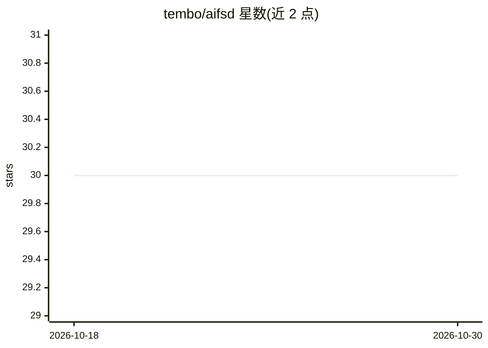

# tembo/aifsd

⭐ 30 · 推送 2026-08-10 · [GitHub](https://github.com/tembo/aifsd) · 组织维护

**AI 优先软件开发宣言：11 条人机协作原则**

一份由 Tembo 发起的 AI 优先软件开发（AIFSD）宣言文档，面向采用 AI 辅助编码的开发团队。内容为 11 条工作流原则：让 AI 写第一稿、开发者负责合并与测试、以初级开发者标准审查 AI 产出、异步工作流自动化、人类拥有最终决定权等。文末提供签名列表，并列出开源与商业 AI 编码工具清单。本仓库为纯文档，无代码、无安装步骤。

## 筛选速览

| 维度 | 判定 | 备注 |
|---|---|---|
| AI 角色 | `ai-knowledge` | 知识聚合/清单类 |
| 许可风险 | `none` | — |
| 部署形态 | `None` |  |
| 模型依赖 | — | README 未给出锁定关系 |
| 硬件要求 | — | 无带数字的原话,不猜 |
| 安装摩擦 | `low` | 无编译、无系统依赖或容器化 |
| 成熟度 | — | 结构信号不足 |

## 能力要点

- 11 条 AI 辅助开发工作流原则
- 开放签名机制（通过 PR 加入签名列表）
- 附开源与商业 AI 编码工具清单（Aider、Cursor、Copilot 等）

## 适用场景

- 团队制定 AI 辅助开发工作流规范时参考
- 了解 AI 编码工具生态的开源与商业选项
- 作为个人使用 AI 编码助手的行为准则

## 场景标签

 · 领域:软件开发方法论

## 证据(README 行号)

> L1: # The AI-First Software Development (AIFSD) Manifesto
> L5: ## Principles

## 星数曲线

2026-10-18 30 → 2026-10-30 30（+0）

---
*卡片 v1 · prompt 1.4 · 生成 2026-10-26 · 置信度 high · 依据 README sha `a8aa212e2b5c` · [字段定义](../../DATASET.md)*
