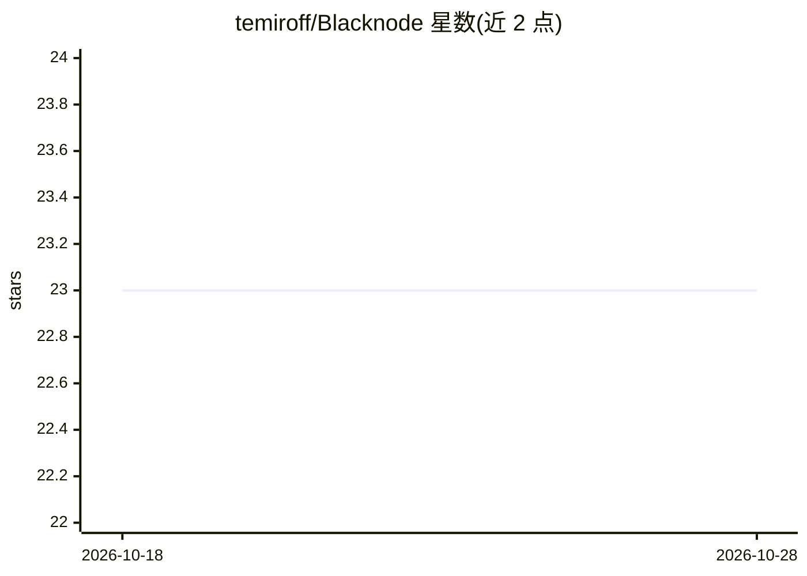

# temiroff/Blacknode

⭐ 23 · Python · Apache-2.0 · 推送 2026-09-13 · [GitHub](https://github.com/temiroff/Blacknode) · 组织维护

**机器人与 AI 的可视化节点工作流编辑与部署平台**

面向机器人开发者的类型化节点编辑器与运行时：在工作流中连接硬件、感知、运动、AI、数据、训练与仿真，平台负责连接校验、图执行、结果检查与回放。支持通过 SSH 配对 Jetson、树莓派等设备并安装运行时，做物理部署或采集-训练-仿真-部署闭环；物理运动默认解除武装并受标定、限位、授权等安全机制约束。核心 Apache-2.0 开源，提供按 GPU 秒计费的 Blacknode Cloud 托管执行。需 Python 3.11+ 与 Node.js 20.19+/22.12+，启动脚本安装本地依赖并打开 localhost:3000。

## 筛选速览

| 维度 | 判定 | 备注 |
|---|---|---|
| AI 角色 | `ai-ecosystem` | LLM/agent 周边工具 |
| 许可风险 | `permissive` | Apache-2.0 |
| 部署形态 | `None` |  |
| 模型依赖 | — | README 未给出锁定关系 |
| 硬件要求 | — | 无带数字的原话,不猜 |
| 安装摩擦 | `medium` | 含编译或系统依赖之一 |
| 成熟度 | — | 结构信号不足 |

## 能力要点

- 类型化节点工作流编辑器与运行时，含校验、回放与部署管理
- SSH 配对远程设备（Jetson/树莓派）并从编辑器安装运行时、发现机器人
- 包系统扩展 ROS 2、CUDA、感知、训练、仿真（Newton 物理）等能力
- 同一工作流格式可本地、配对设备或 Blacknode Cloud（GPU 秒计费）运行

## 适用场景

- 搭建机器人感知-运动-仿真工作流并部署到实体机器人
- 在 Jetson 等远程设备上运行含 CUDA 的 SLAM/感知任务
- 把工作流打包成团队操作界面（App）分享使用
- 需要按需 GPU 算力时把工作流提交到云端托管执行

## 场景标签

`工作流自动化` · 领域:效率与自动化

## 证据(README 行号)

> L10: Blacknode is a typed node editor and runtime for robotics. Workflows connect
> L156: Blacknode is Apache-2.0 software with a usage-based cloud service. The editor,

## 星数曲线

2026-10-18 23 → 2026-10-28 23（+0）

---
*卡片 v1 · prompt 1.4 · 生成 2026-10-27 · 置信度 high · 依据 README sha `10e1c1fbeaa6` · [字段定义](../../DATASET.md)*
