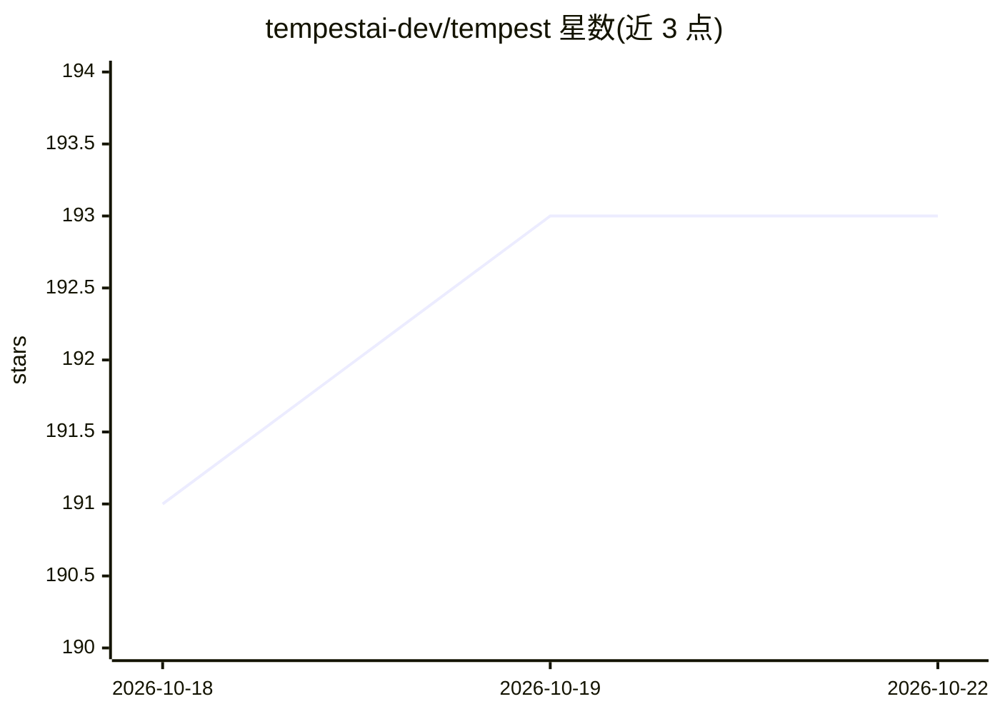

# tempestai-dev/tempest

⭐ 194 · TypeScript · Apache-2.0 · 推送 2026-10-22 · [GitHub](https://github.com/tempestai-dev/tempest) · [官网](https://tempestai.dev) · 组织维护

**并行运行 Claude Code、Codex 等 CLI Agent 的桌面管理器**

基于 Tauri 的桌面应用，用于在同一窗口并行运行 Claude Code、Codex CLI、Gemini CLI、Opencode、Cline 等多个 CLI Agent，每个会话运行在独立的 git worktree 与分支中，避免相互冲突。核心机制是本地代码知识图谱（Token Intelligence），索引一次代码库后供所有会话共享，README 给出 7 个开源仓库的 token 与工具调用节省基准。内置 Hephaestus 进程隔离层（Windows Job Objects/macOS Seatbelt/Linux bubblewrap），默认以跳过权限模式启动各 Agent，可在设置中关闭。提供 Windows/macOS/Linux 预构建二进制，也可用 Node.js 20+ 与 Rust 1.77+ 从源码构建。

## 筛选速览

| 维度 | 判定 | 备注 |
|---|---|---|
| AI 角色 | `ai-ecosystem` | LLM/agent 周边工具 |
| 许可风险 | `permissive` | Apache-2.0 |
| 部署形态 | `library` | 以包/库形式分发 |
| 模型依赖 | — | README 未给出锁定关系 |
| 硬件要求 | — | 无带数字的原话,不猜 |
| 安装摩擦 | `low` | 无编译、无系统依赖或容器化 |
| 成熟度 | — | 结构信号不足 |

## 能力要点

- 本地代码知识图谱供并行 Agent 会话共享，减少 token 与工具调用
- 每个会话独立 git worktree/分支隔离，内置 diff 审查与开 PR
- Hephaestus 进程隔离层覆盖 Windows/macOS/Linux 三平台
- 默认以跳过权限模式启动 Agent，可在设置中切换

## 适用场景

- 同时让多个 CLI Agent 在同一代码库上并行开发而不互相干扰
- 审查各 Agent 的改动并直接提交、推送、开 PR
- 降低多 Agent 并行时的 token 消耗

## 场景标签

 · 领域:开发者工具/Agent 编排

## 证据(README 行号)

> L63: Claude Code, Codex CLI, Gemini CLI, Opencode, Copilot CLI, Cline, Goose — all running in parallel, each in its own 
> L33:  Run Claude Code, Codex, Gemini and any other CLI Agent with 86% fewer tokens

## 星数曲线

2026-10-18 191 → 2026-10-22 193（+2）

---
*卡片 v1 · prompt 1.4 · 生成 2026-10-22 · 置信度 high · 依据 README sha `ee65ad88204a` · [字段定义](../../DATASET.md)*
