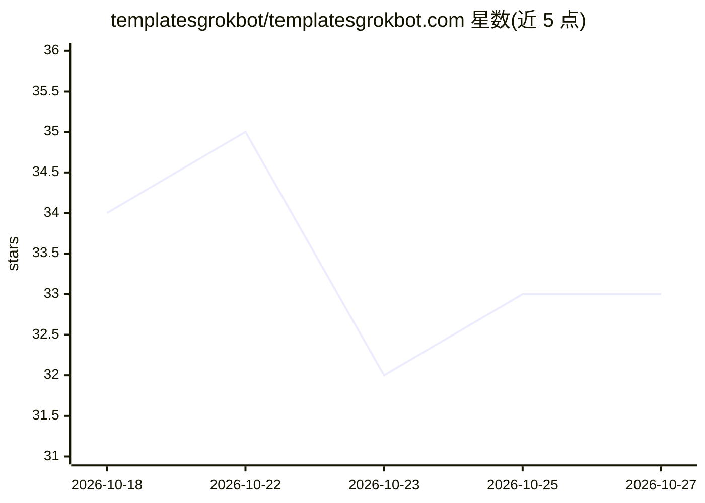

# templatesgrokbot/templatesgrokbot.com

⭐ 33 · MIT · 推送 2026-10-16 · [GitHub](https://github.com/templatesgrokbot/templatesgrokbot.com) · [官网](https://templatesgrokbot.com/) · 个人维护

**10,464 个 Grok Bot 提示词模板库：按职业/工作类型检索安装**

面向使用 xAI Grok Bot 的用户与 agent 的模板目录：收录 10,464 个 Markdown 格式的 Bot 模板，按 21 个职业领域和 27 类工作组织，可按任务/职位搜索。使用方式为复制 .md 内容粘贴给 Grok Bot 完成自我配置；付费 job plan（$29/年）提供按职位匹配、自动安装与每周更新，并提供 MCP 服务器（Streamable HTTP、OAuth 2.1/bearer key、4 个只读工具）接入 agent。3,945 个模板改编自他人作品并保留原许可（多为 CC BY/MIT），本库自身工作为 MIT。

## 筛选速览

| 维度 | 判定 | 备注 |
|---|---|---|
| AI 角色 | `ai-knowledge` | 知识聚合/清单类 |
| 许可风险 | `permissive` | MIT |
| 部署形态 | `None` |  |
| 模型依赖 | — | README 未给出锁定关系 |
| 硬件要求 | — | 无带数字的原话,不猜 |
| 安装摩擦 | `low` | 无编译、无系统依赖或容器化 |
| 成熟度 | — | 结构信号不足 |

## 能力要点

- 10,464 个模板，21 个职业领域 × 27 类工作组织
- MCP 服务器提供 templates_for_job / get_template / search_templates / list_categories 四个只读工具
- 每个模板含 Identity/Capabilities/Connectors/Boundaries/First run 结构化段落
- 3,945 个改编模板逐文件标注 adapted_from 与原许可

## 适用场景

- 按我的职位找到适用的 Grok Bot 模板并复制安装
- 让 agent 通过 MCP 检索整个模板目录自动配置 Bot 团队
- 开发者通过 catalog.json 与网站 API 程序化访问模板

## 场景标签

`提示工程` `精选清单` · 领域:Agent 开发

## 证据(README 行号)

> L9:  A library of 10,000+ ready-made Grok Bot templates
> L11:  TemplatesGrokBot.com is a library of 10,000+ ready-made Grok Bot templates. Search by task or job title,
> L125: Your Grok Bot can search this catalog itself through the TemplatesGrokBot MCP server, part of the job plan.

## 星数曲线

2026-10-18 34 → 2026-10-27 33（-1）

---
*卡片 v1 · prompt 1.4 · 生成 2026-10-25 · 置信度 high · 依据 README sha `caa29f4ea8fa` · [字段定义](../../DATASET.md)*
