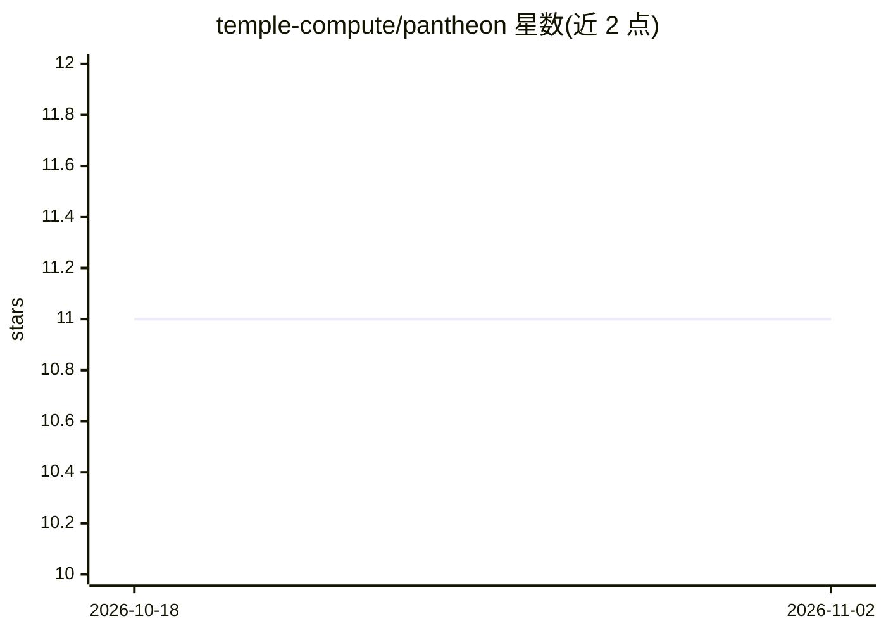

# temple-compute/pantheon

⭐ 11 · Python · MIT · 推送 2026-10-28 · [GitHub](https://github.com/temple-compute/pantheon) · [官网](https://templecompute.com) · 组织维护

**面向 Horus Runtime 的生产级科学计算工作流集合：MD、虚拟筛选、对接、LLM 训练等**

temple-compute/pantheon 收录面向 Horus Runtime 运行的多阶段科学计算工作流，覆盖药物发现（虚拟筛选、分子对接、MD 建模）、BioExcel 构建块、生物信息学、化学、AI（从零预训练/微调 LLM、交易分类微调）、组学与临床试验模拟等类别，共 40 余个条目。每个工作流目录含 README、workflow.yaml 或 run.py 定义及脚本；Horus 引擎按阶段自动路由到 HPC、云或本地算力，支持流式日志、失败重试与可溯源的类型化工件。安装通过 uv，BioExcel 工作流额外要求 PATH 上有 conda 系工具以构建 GROMACS/AMBER 环境。

## 筛选速览

| 维度 | 判定 | 备注 |
|---|---|---|
| AI 角色 | `ai-ecosystem` | LLM/agent 周边工具 |
| 许可风险 | `permissive` | MIT |
| 部署形态 | `None` |  |
| 模型依赖 | — | README 未给出锁定关系 |
| 硬件要求 | — | 无带数字的原话,不猜 |
| 安装摩擦 | `low` | 无编译、无系统依赖或容器化 |
| 成熟度 | — | 结构信号不足 |

## 能力要点

- 40 余个工作流覆盖分子动力学、虚拟筛选、对接、LLM 训练等科学计算场景
- 声明式 workflow.yaml 或 Python 构建器（run.py）定义多阶段流水线
- Horus 引擎按阶段自动路由 HPC/云/本地算力，提供日志流、重试与类型化工件
- 含引擎特性演示（fan-out/map/gather、运行时动态 DAG、子工作流复用）

## 适用场景

- 用 AutoDock Vina/Boltz-2 对配体库做虚拟筛选与对接
- 以 GROMACS/AMBER 完成蛋白质及复合物的分子动力学建模
- 从零预训练或微调小型 LLM 并评测（GSM8K/TinyStories）
- 在异构算力（HPC/云/本地）上一键运行多阶段科学流水线

## 场景标签

`工作流自动化` `模型训练` `微调` · 领域:效率与自动化

## 证据(README 行号)

> L8: > Production-ready scientific workflows for the **Horus Runtime**. Molecular dynamics, virtual screening, docking, L
> L96: |W-28|LLM From Scratch - Pretrain, SFT & Eval|Clone a from-scratch Transformer repo, tokenize Pile/instruction data

## 星数曲线

2026-10-18 11 → 2026-11-02 11（+0）

---
*卡片 v1 · prompt 1.4 · 生成 2026-11-01 · 置信度 high · 依据 README sha `5b851087e7fb` · [字段定义](../../DATASET.md)*
