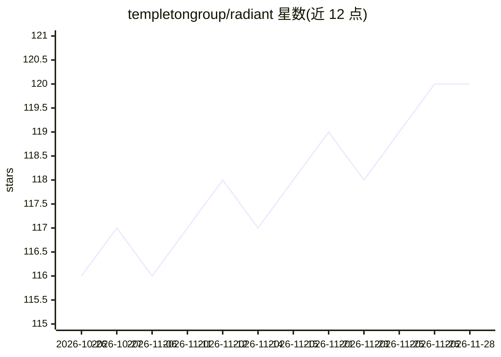

# templetongroup/radiant

⭐ 120 · JavaScript · MIT · 推送 2026-11-16 · [GitHub](https://github.com/templetongroup/radiant) · [官网](https://templetongroup.dev/showcase/radiant/) · 组织维护

**Mac 本地编程 Agent 桌面应用：云/本地模型统一对话与终端**

面向 Mac 用户的本地编程 harness：Electron 应用内与编码 Agent 对话，Agent 可在项目文件夹读写文件、运行 shell 命令，实时活动面板展示每次工具调用，内置真实终端。支持 Anthropic、OpenAI、OpenRouter、Groq 等云模型及 Ollama、LM Studio 本地模型，可用订阅登录或 API key。提供任务看板、Loops、Graphs 等长任务编排，命令沙箱与逐应用控制权限，文件编辑留检查点可撤销。仅支持 Apple Silicon。

## 筛选速览

| 维度 | 判定 | 备注 |
|---|---|---|
| AI 角色 | `ai-native` | 本体是模型或模型工具 |
| 许可风险 | `permissive` | MIT |
| 部署形态 | `desktop` | 安装包/桌面程序 |
| 模型依赖 | local-ok | 支持本地模型 |
| 硬件要求 | — | 无带数字的原话,不猜 |
| 安装摩擦 | `low` | 无编译、无系统依赖或容器化 |
| 成熟度 | — | 结构信号不足 |

## 能力要点

- 跨云与本地模型的 Agent 对话，会话以中性格式存储可中途切换模型
- 实时活动面板与内置真实终端（node-pty + xterm.js）
- 任务看板/Loops/Graphs 长任务编排，按 token 与金额预算控制
- 本地模型按当前机器标注 Runs well / Runs tight / Won't run

## 适用场景

- 在 Mac 上让 AI Agent 直接读写项目文件并执行命令
- 用本地 Ollama/LM Studio 模型离线跑编码 Agent
- 把长任务拆成看板任务、循环或依赖图让 Agent 自主推进
- 在手机上通过 MLX 直接运行开放模型对话

## 场景标签

`编码 Agent` · 领域:编码与开发

## 证据(README 行号)

> L6:  A local coding harness for your Mac: chat with coding agents across cloud and
> L42: - **Agent chat** with streaming replies and visible model thinking, on any
> L197: - `server/` — Express + WebSocket backend: streaming provider clients

## 星数曲线

2026-10-26 116 → 2026-11-28 120（+4）

---
*卡片 v1 · prompt 1.4 · 生成 2026-11-28 · 置信度 high · 依据 README sha `78c7fdd5a1a8` · [字段定义](../../DATASET.md)*
