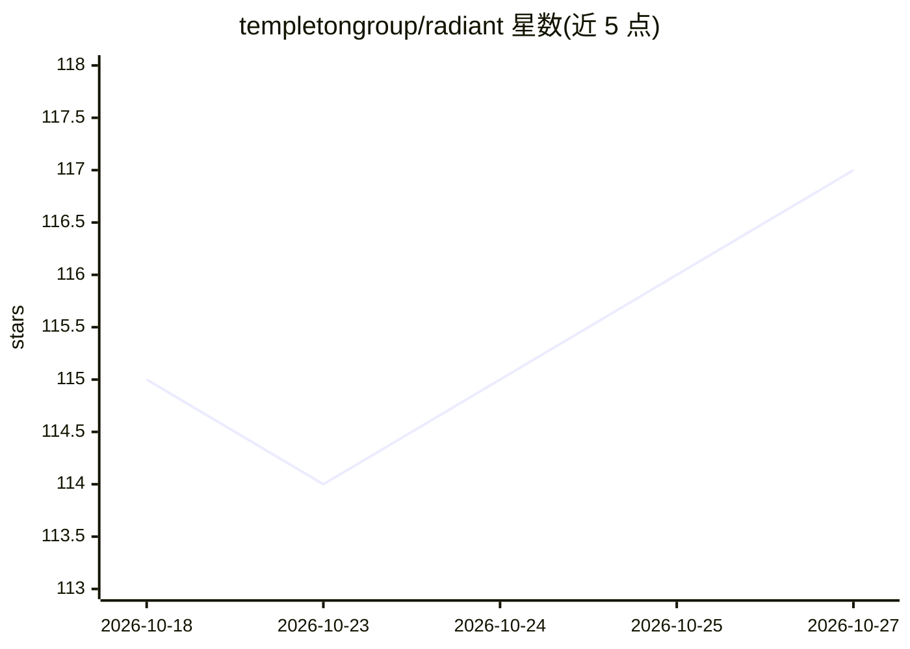

# templetongroup/radiant

⭐ 117 · JavaScript · MIT · 推送 2026-10-21 · [GitHub](https://github.com/templetongroup/radiant) · [官网](https://templetongroup.dev/showcase/radiant/) · 组织维护

**Mac 本地编码代理客户端：聚合云端与本地模型聊天驱动代理**

面向 Mac 的本地编码 harness（Electron 应用）：在一个窗口中与编码代理聊天，代理可读写文件、运行 shell 命令、控制浏览器与桌面（逐应用授权）；提供实时活动流、真实终端、变更面板与撤销检查点。支持 Anthropic/OpenAI/OpenRouter/xAI/Groq 等云端模型及 Ollama、LM Studio 本地模型，也可用 Claude/ChatGPT 等订阅登录。另有任务看板、自检循环、并行图等工作流机制，及 iPhone/iPad 版（MLX 本地运行）。MIT 许可，由 Templeton Technologies 发布。

## 筛选速览

| 维度 | 判定 | 备注 |
|---|---|---|
| AI 角色 | `ai-native` | 本体是模型或模型工具 |
| 许可风险 | `permissive` | MIT |
| 部署形态 | `desktop` | 安装包/桌面程序 |
| 模型依赖 | local-ok | 支持本地模型 |
| 硬件要求 | — | 无带数字的原话,不猜 |
| 安装摩擦 | `low` | 无编译、无系统依赖或容器化 |
| 成熟度 | — | 结构信号不足 |

## 能力要点

- 代理可读写文件、跑 shell 命令、经 Chrome 扩展控制浏览器与桌面（逐应用授权）
- 云端多提供商与 Ollama/LM Studio 本地模型，可在对话中切换模型并保留上下文
- 本地模型下载前按本机标注 Runs well/Runs tight/Won't run
- 任务看板、自检循环与并行图工作流；变更面板含 diff 与撤销检查点

## 适用场景

- 在 Mac 上用本地或云端模型驱动的代理处理项目编码任务
- 通过订阅登录（Claude/ChatGPT 等）或 API key 使用已有模型服务
- 跟踪代理每一步工具调用并审查、回滚文件变更

## 场景标签

`编码 Agent` `GUI 自动化` · 领域:效率与自动化

## 证据(README 行号)

> L6:  A local coding harness for your Mac: chat with coding agents across cloud and
> L42: - **Agent chat** with streaming replies and visible model thinking, on any

## 星数曲线

2026-10-18 115 → 2026-10-27 117（+2）

---
*卡片 v1 · prompt 1.4 · 生成 2026-10-23 · 置信度 high · 依据 README sha `411c3b9e96ec` · [字段定义](../../DATASET.md)*
