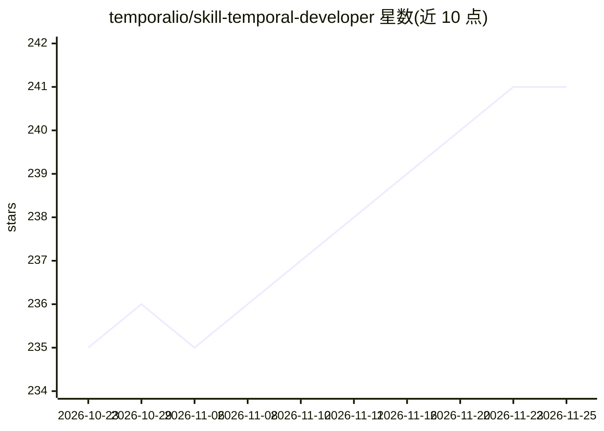

# temporalio/skill-temporal-developer

⭐ 241 · MIT · 推送 2026-11-24 · [GitHub](https://github.com/temporalio/skill-temporal-developer) · [官网](https://temporal.io) · 组织维护

**给编码 agent 用的 Temporal 开发技能包**

Temporal 官方发布的开发技能（skill），供开发者在构建 Temporal 应用时供编码 agent 加载使用。以插件形式打包适配 Claude Code、Cursor、OpenAI Codex 等主流编码 agent，也可通过 npx skills 安装到多个 agent，或手动 git clone 到 Claude/Codex 的技能目录。覆盖 Temporal SDK 的 Python、TypeScript、Go、Java、.NET、Ruby、PHP 等语言，Rust 处于 Public Preview。通过 Community Slack 的 #topic-ai 频道收集反馈。

## 筛选速览

| 维度 | 判定 | 备注 |
|---|---|---|
| AI 角色 | `ai-knowledge` | 知识聚合/清单类 |
| 许可风险 | `permissive` | MIT |
| 部署形态 | `library` | 以包/库形式分发 |
| 模型依赖 | — | README 未给出锁定关系 |
| 硬件要求 | — | 无带数字的原话,不猜 |
| 安装摩擦 | `low` | 无编译、无系统依赖或容器化 |
| 成熟度 | — | 结构信号不足 |

## 能力要点

- 以插件形式适配 Claude Code、Cursor、OpenAI Codex 三类编码 agent
- 支持 npx skills 一条命令安装到所有主流编码 agent
- 覆盖 8 种 Temporal SDK 语言（Python/TypeScript/Go/Java/.NET/Rust/Ruby/PHP）

## 适用场景

- 让编码 agent 在编写 Temporal 工作流代码时加载该技能
- 在 Claude Code 或 Cursor 中以插件方式获取技能更新
- 为团队统一配置 Temporal 开发的 agent 知识

## 场景标签

`编码 Agent` · 领域:编码与开发

## 证据(README 行号)

> L3: A comprehensive skill for developers to use when building Temporal applications.
> L11: This skill is packaged as a plugin for major coding agents, which provides a simple way to install and receive futu
> L25: 1. `npx skills add temporalio/skill-temporal-developer`

## 星数曲线

2026-10-23 235 → 2026-11-25 241（+6）

---
*卡片 v1 · prompt 1.4 · 生成 2026-11-25 · 置信度 high · 依据 README sha `6c03176f93e3` · [字段定义](../../DATASET.md)*
