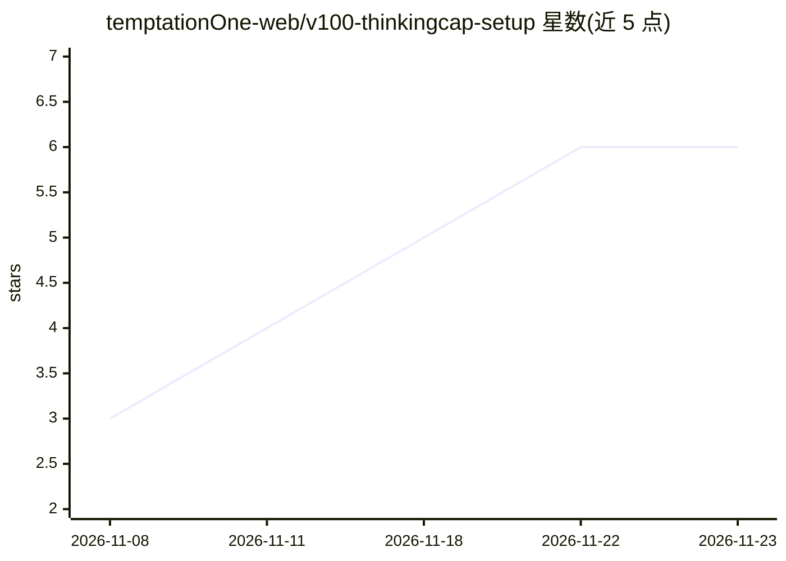

# temptationOne-web/v100-thinkingcap-setup

⭐ 6 · Python · Apache-2.0 · 推送 2026-11-21 · [GitHub](https://github.com/temptationOne-web/v100-thinkingcap-setup) · 个人维护

**在 4×V100 上跑 Qwen3.8 NVFP4 MoE 模型的搭建配方与基准**

一份在 4×Tesla V100 32GB（PCIe、无 NVLink）上运行 ThinkingCap-Qwen3.8-Flash-Next NVFP4 模型的实践配置：基于 1Cat-vLLM fork 为 SM70 构建引擎，附 12 个 vLLM 补丁、可选运行时插件、启动脚本与 systemd drop-ins，并给出实测基准（单用户约 160 tok/s、4 用户约 340 tok/s、LiveCodeBench 55/61）。面向拥有 2–4 张 V100 32GB 的用户；模型权重需从 Hugging Face 另行下载，引擎需源码编译（约 1 小时）。

## 筛选速览

| 维度 | 判定 | 备注 |
|---|---|---|
| AI 角色 | `ai-ecosystem` | LLM/agent 周边工具 |
| 许可风险 | `permissive` | Apache-2.0 |
| 部署形态 | `library` | 以包/库形式分发 |
| 模型依赖 | local-ok | 支持本地模型 |
| 硬件要求 | — | 无带数字的原话,不猜 |
| 安装摩擦 | `medium` | 含编译或系统依赖之一 |
| 成熟度 | — | 结构信号不足 |

## 能力要点

- 12 个 vLLM 补丁与多个可选运行时插件（每项可单独开关）
- 实测数据：单用户约 160–170 tok/s，4 用户约 340 tok/s
- LiveCodeBench easy+medium 55/61，工具调用测试 15/15
- 附冻结依赖清单、构建脚本与启动脚本

## 适用场景

- 在无 NVLink 的旧 V100 服务器上运行现代 MoE 本地模型
- 参考补丁与配置复现同硬件环境的本地推理部署
- 对比同一硬件上多个模型的速度与代码测试得分

## 场景标签

`推理引擎` · 领域:训练与推理

## 证据(README 行号)

> L3: **What this is:** a working recipe for running a modern 2026 MoE model, ThinkingCap-Qwen3.8-Flash-Next (NVFP4), fast
> L19: 3. Build 1Cat-vLLM main (commit `e098ee11b` or newer) for SM70: see `engine/build.sh` (~1 hour on my 36-thread Xeon
> L40: - **Engine**: 1Cat-vLLM main (`e098ee11b`, 2026-11-05) + my 12 patches + FLy. TP4, 262,144 context.

## 星数曲线

2026-11-08 3 → 2026-11-23 6（+3）

---
*卡片 v1 · prompt 1.4 · 生成 2026-11-21 · 置信度 high · 依据 README sha `a29939f9342f` · [字段定义](../../DATASET.md)*
