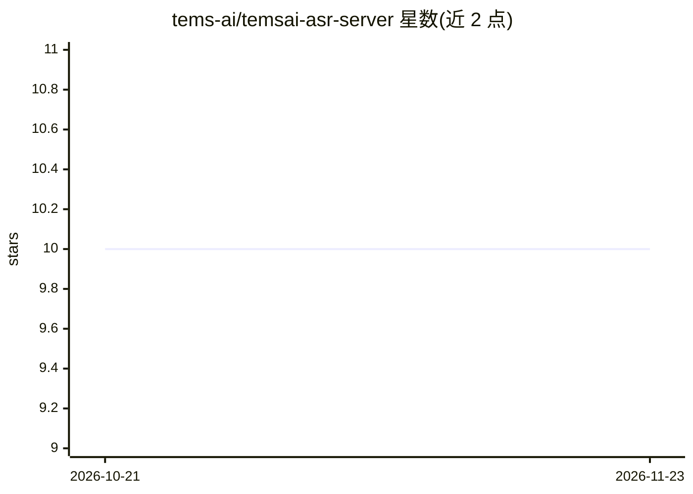

# tems-ai/temsai-asr-server

⭐ 10 · Python · Apache-2.0 · 推送 2026-11-18 · [GitHub](https://github.com/tems-ai/temsai-asr-server) · [官网](https://tems.ai) · 组织维护

**自托管的 Parakeet-TDT 语音转写服务器，兼容 OpenAI/Whisper API**

为 NVIDIA Parakeet-TDT 模型提供的自托管语音转文字服务器，暴露与 OpenAI /whisper-1 相同的 /v1/audio/transcriptions 端点，现有 Whisper 客户端改 base URL 即可接入。支持 CPU 与 NVIDIA GPU、amd64/arm64、Docker Compose 与 Kubernetes（Helm chart 及原生 manifests），可通过 BAKE_MODEL 将模型打进镜像以适配气隙集群；可选 RNNoise/谱减降噪前端，面向工厂等嘈杂工业音频场景。源码 Apache-2.0，官方镜像商用生产需商业许可。

## 筛选速览

| 维度 | 判定 | 备注 |
|---|---|---|
| AI 角色 | `ai-native` | 本体是模型或模型工具 |
| 许可风险 | `permissive` | Apache-2.0 |
| 部署形态 | `self-host` | docker 或自建部署 |
| 模型依赖 | — | README 未给出锁定关系 |
| 硬件要求 | — | 无带数字的原话,不猜 |
| 安装摩擦 | `low` | 无编译、无系统依赖或容器化 |
| 成熟度 | — | 结构信号不足 |

## 能力要点

- OpenAI/Whisper 兼容 API，支持 json/verbose_json/srt/vtt 等响应格式与逐词时间戳、置信度
- 25 种欧洲语言自动检测，可选英文专用模型路由 language=en
- CPU/GPU、amd64/arm64 多架构镜像，气隙部署可用（模型烘焙进镜像）
- 可选 RNNoise 与 DSP 谱减两种降噪前端，附噪声基准测试脚本

## 适用场景

- 把现有 Whisper 客户端切换到本地引擎而不改代码
- 工厂车间录音的本地化转写，音频不出内网
- 在气隙 Kubernetes 集群中部署语音转写服务
- 对嘈杂工业音频先评测降噪前端再决定是否开启

## 场景标签

`语音识别` · 领域:感知与多模态

## 证据(README 行号)

> L10: A self-hosted speech-to-text server for **NVIDIA Parakeet-TDT** models with an
> L45: - It runs **fully on premises**: CPU or GPU, x86 or ARM, Docker or Kubernetes,
> L50: - It **speaks the OpenAI API**, so existing Whisper clients and tools switch to

## 星数曲线

2026-10-21 10 → 2026-11-23 10（+0）

---
*卡片 v1 · prompt 1.4 · 生成 2026-11-20 · 置信度 mid · 依据 README sha `f32d4dcbf266` · [字段定义](../../DATASET.md)*
