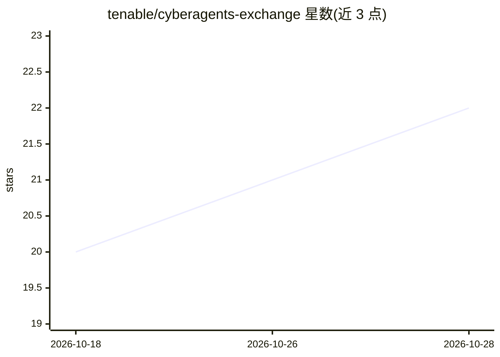

# tenable/cyberagents-exchange

⭐ 22 · Python · 推送 2026-10-23 · [GitHub](https://github.com/tenable/cyberagents-exchange) · [官网](https://exchange.tenable.com) · 组织维护

**网络安全 AI agent 社区目录：索引 agent/技能/MCP 服务器/剧本**

由 Tenable 维护的开源社区目录（CyberAgents Exchange）内容源，收录面向网络安全的开源 AI agent、技能、MCP 服务器与多 agent 剧本四类条目。仓库只存条目元数据（每条一个 markdown 文件，YAML frontmatter + 正文），代码留在贡献者自己的 GitHub 仓库。PR 提交后由 validator.py 自动校验字段与受控词表，两名维护者人工审核，合并后发布到 exchange.tenable.com。厂商中立，条目许可由各作者自行声明。

## 筛选速览

| 维度 | 判定 | 备注 |
|---|---|---|
| AI 角色 | `ai-knowledge` | 知识聚合/清单类 |
| 许可风险 | `none` | — |
| 部署形态 | `None` |  |
| 模型依赖 | — | README 未给出锁定关系 |
| 硬件要求 | — | 无带数字的原话,不猜 |
| 安装摩擦 | `low` | 无编译、无系统依赖或容器化 |
| 成熟度 | — | 结构信号不足 |

## 能力要点

- 索引四类内容：agents、skills、MCP servers、playbooks
- 每条目为单 markdown 文件，代码留在原作者仓库
- PR 提交后由 validator.py 自动校验 + 双人审核
- 厂商中立，免费上架与使用，无平台/许可锁定

## 适用场景

- 安全团队发现可复用的开源 AI agent 与 MCP 服务器
- 贡献者通过 PR 把自己的安全 agent 上架到目录
- 查阅安全场景的多 agent 剧本工作流

## 场景标签

 · 领域:网络安全/知识聚合

## 证据(README 行号)

> L16: This repository is the content source for the CyberAgents Exchange — a community directory of open-source AI agents
> L24: CyberAgents Exchange is a directory, not a code host. **Listing metadata lives here — the actual agent code lives i

## 星数曲线

2026-10-18 20 → 2026-10-28 22（+2）

---
*卡片 v1 · prompt 1.4 · 生成 2026-10-28 · 置信度 high · 依据 README sha `505e9e76a35e` · [字段定义](../../DATASET.md)*
