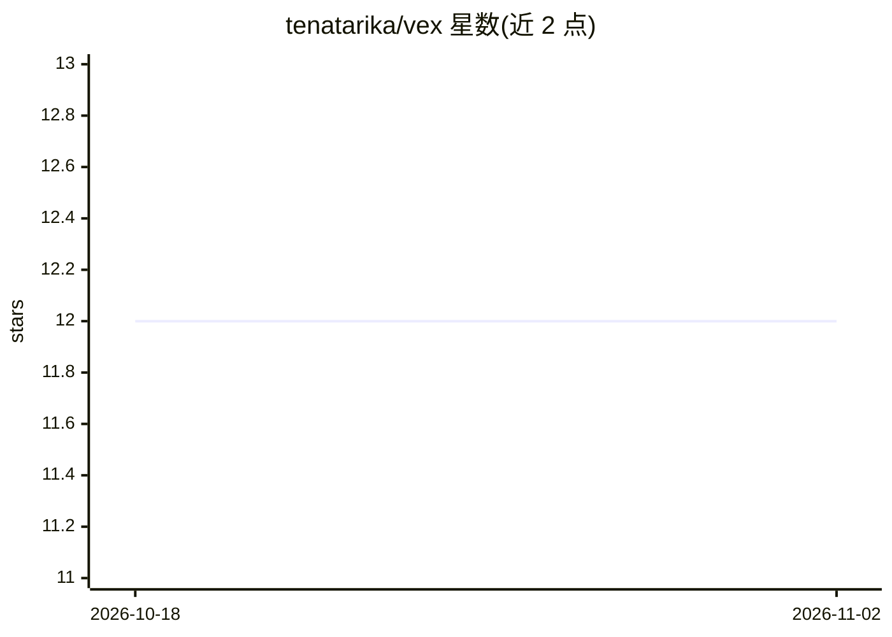

# tenatarika/vex

⭐ 12 · Rust · MIT · 推送 2026-10-18 · [GitHub](https://github.com/tenatarika/vex) · 个人维护

**面向 AI agent 的混合代码检索工具（结构+语义）**

Rust 编写的单二进制代码索引与检索工具：用 tree-sitter 对 20 种语言建索引，提供符号存在性检查、类体提取、binder 级引用查找、调用图查询等命令。检索为三通道混合：结构 FST + BM25 + 语义 HNSW 嵌入（可插拔 embedder），经 RRF 融合，号称索引后查询约 4-5ms。语义搜索为可选（--semantic），结构搜索无需模型下载。自带 MCP server 供 Claude Code 等 agent 集成。非 LSP 替代，无重构与依赖内跳转；动态分发、类级装饰器等不可见（LIMITATIONS.md）。macOS/Linux/Windows 提供预编译二进制。

## 筛选速览

| 维度 | 判定 | 备注 |
|---|---|---|
| AI 角色 | `ai-enhanced` | 去掉 AI 部分产品仍成立 |
| 许可风险 | `permissive` | MIT |
| 部署形态 | `desktop` | 安装包/桌面程序 |
| 模型依赖 | — | README 未给出锁定关系 |
| 硬件要求 | — | 无带数字的原话,不猜 |
| 安装摩擦 | `high` | 编译与系统依赖俱全 |
| 成熟度 | — | 结构信号不足 |

## 能力要点

- 结构 FST + BM25 + 语义 HNSW 三通道检索，RRF 融合
- 持久化调用图：vex callers/callees 毫秒级查询
- tree-sitter 索引 20 种语言，8 种语言支持 type-aware --strict usages
- 单二进制、零配置、无 Docker/LSP，附带 MCP server

## 适用场景

- AI agent 编码工作流中做 token 高效的符号检索
- 大型代码库中按名称或语义查找符号与提取类体
- 分析谁调用了某符号（callers/callees）

## 场景标签

`语义搜索` · 领域:知识与检索

## 证据(README 行号)

> L10: Fast hybrid structural + semantic code search. **V**ector + ind**ex**.
> L26: - **3-channel hybrid search** — structural FST (names) + BM25 (rare body terms) + semantic HNSW (meaning), fused vi
> L82: - The first `vex index --semantic` downloads the ~86 MB embedding model; structural search needs no download.

## 星数曲线

2026-10-18 12 → 2026-11-02 12（+0）

---
*卡片 v1 · prompt 1.4 · 生成 2026-10-31 · 置信度 high · 依据 README sha `5535a353d6fb` · [字段定义](../../DATASET.md)*
