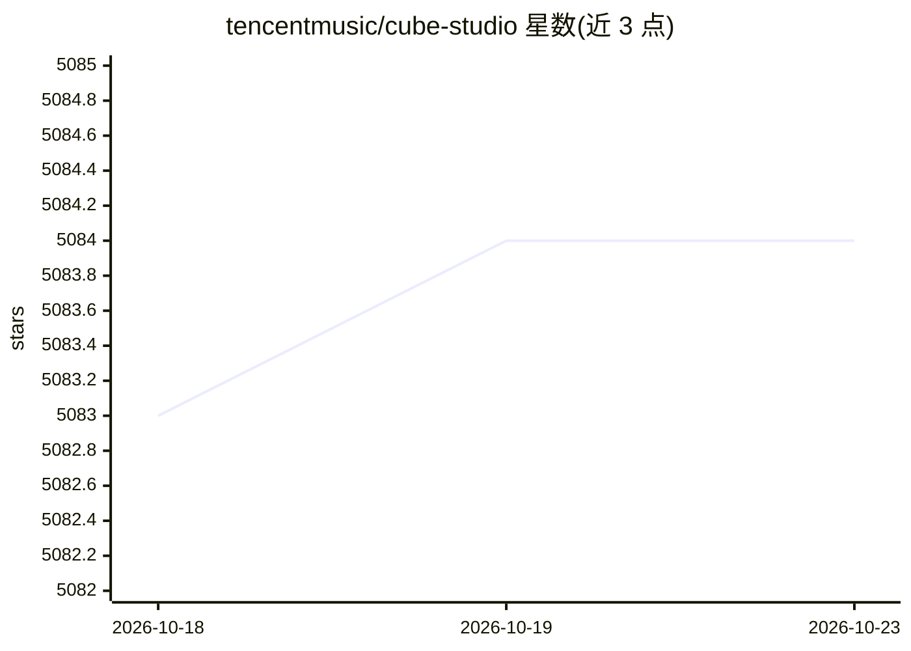

# tencentmusic/cube-studio

⭐ 5,084 · NOASSERTION · 推送 2026-10-09 · [GitHub](https://github.com/tencentmusic/cube-studio) · 组织维护 · 中文 README

**腾讯开源的云原生一站式机器学习/大模型 AI 平台（已归档）**

云原生机器学习/深度学习/大模型一站式平台，覆盖 MLOps 全流程：notebook 在线开发、拖拉拽 pipeline 编排、多机多卡分布式训练、超参搜索、推理服务与 VGPU 虚拟化、边缘计算、标注平台，以及大模型 SFT 微调/强化学习训练、vllm/ollama/mindie 多机推理、私有知识库与 AI 模型市场。当前 README 仅显示归档声明与帮助文档链接，仓库已停止维护并跳转至新仓库，具体安装与使用细节需查阅帮助文档。

## 筛选速览

| 维度 | 判定 | 备注 |
|---|---|---|
| AI 角色 | `ai-ecosystem` | LLM/agent 周边工具 |
| 许可风险 | `none` | NOASSERTION |
| 部署形态 | `None` |  |
| 模型依赖 | — | README 未给出锁定关系 |
| 硬件要求 | — | 无带数字的原话,不猜 |
| 安装摩擦 | `low` | 无编译、无系统依赖或容器化 |
| 成熟度 | — | 结构信号不足 |

## 能力要点

- MLOps 全流程：notebook、pipeline 编排、分布式训练、超参搜索
- 大模型 SFT 微调、奖励模型与强化学习训练
- vllm/ollama/mindie 大模型多机推理与私有知识库
- 推理服务 VGPU 虚拟化，支持国产 CPU/GPU/NPU 昇腾生态

## 适用场景

- 在 Kubernetes 上搭建团队统一的一站式机器学习平台
- 进行大模型微调、强化学习训练与多机推理部署
- 通过拖拉拽 pipeline 编排算法全流程

## 场景标签

`MLOps` `微调` `强化学习` `推理引擎` · 领域:训练与推理

## 证据(README 行号)

> L3: 本仓库已于 2026-05-18 归档，不再维护。 跳转至新仓库
> L9: # Cube Studio

## 星数曲线

2026-10-18 5,083 → 2026-10-23 5,084（+1）

---
*卡片 v1 · prompt 1.4 · 生成 2026-10-20 · 置信度 low · 依据 README sha `31798bbd0b2c` · [字段定义](../../DATASET.md)*
