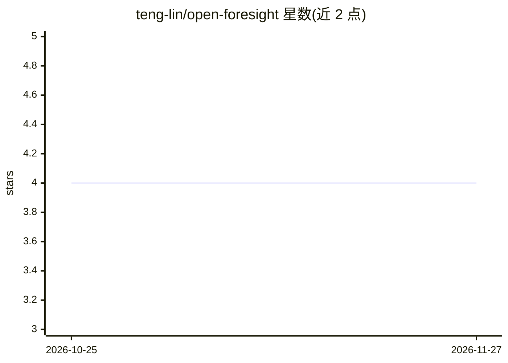

# teng-lin/open-foresight

⭐ 4 · Dart · MIT · 推送 2026-11-22 · [GitHub](https://github.com/teng-lin/open-foresight) · 个人维护

**Linux/macOS 本地离线会议转写与带引用问答的知识库应用**

Flutter 桌面应用，记录并转写麦克风与系统音频，将简短笔记用实时转写扩写为完整笔记，会后生成摘要与行动项；非会议时间作为本地文档库，支持导入文件、网页与 Google Drive 内容并做语义检索。默认本地推理：Gemma 生成答案与笔记，EmbeddingGemma 做来源搜索，Whisper 转写；答案引用经校验，未通过则显示明确的回退标签。提供 MCP server 供 agent 调用导入、搜索、提问、记录功能。Linux 提供 deb/rpm/Arch 包，macOS DMG 为 ad-hoc 签名且未经公证。

## 筛选速览

| 维度 | 判定 | 备注 |
|---|---|---|
| AI 角色 | `ai-native` | 本体是模型或模型工具 |
| 许可风险 | `permissive` | MIT |
| 部署形态 | `desktop` | 安装包/桌面程序 |
| 模型依赖 | — | README 未给出锁定关系 |
| 硬件要求 | — | 无带数字的原话,不猜 |
| 安装摩擦 | `medium` | 含编译或系统依赖之一 |
| 成熟度 | — | 结构信号不足 |

## 能力要点

- 本地推理：Gemma 生成、EmbeddingGemma 检索、Whisper 转写，音频与文档存本地
- Ask 答案引用与来源校验，未通过时显示回退标签
- MCP server 供 agent 通过同一应用服务搜索/导入/提问/记录
- 支持 Tiny 到 Large v3 Turbo 的 Whisper 转写模型与 Vulkan GPU 运行

## 适用场景

- 会议录制转写并生成带行动项的摘要
- 把本地文件与网页建成本地知识库做引用问答
- 为本地优先的笔记工作流提供离线语音转写

## 场景标签

`知识库管理` `文档问答` `语音识别` · 领域:知识与检索

## 证据(README 行号)

> L10: Open Foresight records and transcribes meetings, keeps your notes and recordings locally, and answers questions fro
> L23: - **Ask.** Get grounded answers from a local Gemma model, with citations checked against your sources. If verificat
> L41: - **MCP server.** Agents can import, search, ask, take notes, and record through the same application service the d

## 星数曲线

2026-10-25 4 → 2026-11-27 4（+0）

---
*卡片 v1 · prompt 1.4 · 生成 2026-11-21 · 置信度 mid · 依据 README sha `004aaf46be3c` · [字段定义](../../DATASET.md)*
