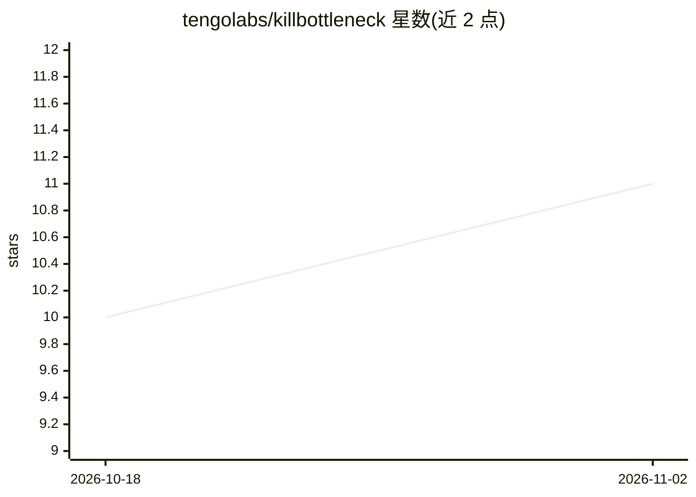

# tengolabs/killbottleneck

⭐ 11 · JavaScript · NOASSERTION · 推送 2026-10-29 · [GitHub](https://github.com/tengolabs/killbottleneck) · [官网](https://killbottleneck.com) · 组织维护

**可自托管的目标/流程地图工具，含 AI 助手、REST API 与 MCP 服务**

面向团队与个人目标管理的自部署 Web 应用：提供目标地图编辑器（节点/状态/备注/分享）、My day 任务面板、时间跟踪、手机简化视图、JSON 导出导入与 HTTPS 部署等完整非 AI 功能。AI 为可选层：侧栏助手可规划日程、整理笔记、起草项目，支持 openai 兼容 API、ollama 本地模型等四种接入方式，默认 KB_AI_PROVIDER=none 时无任何 AI 功能。另内置 MCP 服务器（20 个工具）与 REST API，供 Claude 类 AI 助手读写地图。Fair-code 许可，禁止转售为托管服务。

## 筛选速览

| 维度 | 判定 | 备注 |
|---|---|---|
| AI 角色 | `ai-enhanced` | 去掉 AI 部分产品仍成立 |
| 许可风险 | `none` | NOASSERTION |
| 部署形态 | `self-host` | docker 或自建部署 |
| 模型依赖 | local-ok | 支持本地模型 |
| 硬件要求 | — | 无带数字的原话,不猜 |
| 安装摩擦 | `low` | 无编译、无系统依赖或容器化 |
| 成熟度 | `idea` | |

## 能力要点

- 目标地图编辑器 + My day 面板 + 时间跟踪 + 手机简化视图
- AI 助手/节点魔棒/项目摘要，支持 openai 兼容 API、ollama、自定义端点
- 内置 MCP 服务器（20 个工具）与 REST API，供 AI 代理读写地图
- 默认无外联请求、无遥测，数据不离开自有服务器

## 适用场景

- 团队在自己服务器上做目标与流程管理，不外传数据
- 通过 AI 助手规划日程、整理笔记照片语音、起草项目
- 用 Claude 等 AI 代理经 MCP 对话式编辑地图与任务

## 场景标签

 · 领域:生产力/项目管理

## 证据(README 行号)

> L63: ## What it does without AI
> L96: ## AI features (optional)
> L134: When AI is used, map data is sent to the endpoint you chose; with `none` (the default) nothing

## 星数曲线

2026-10-18 10 → 2026-11-02 11（+1）

---
*卡片 v1 · prompt 1.4 · 生成 2026-11-02 · 置信度 high · 依据 README sha `8a01d76e581a` · [字段定义](../../DATASET.md)*
