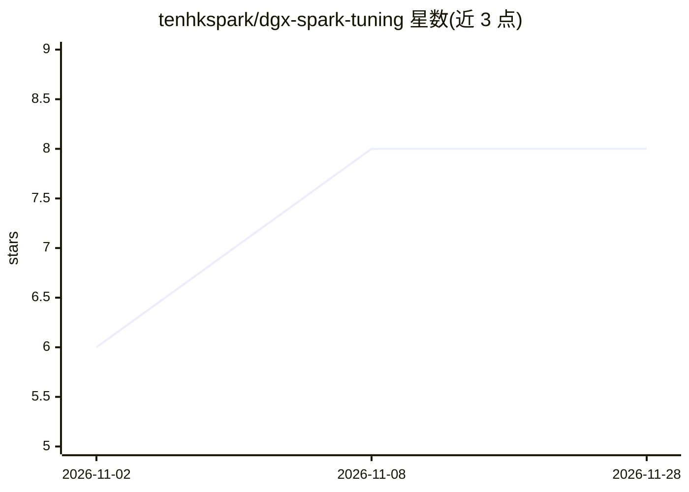

# tenhkspark/dgx-spark-tuning

⭐ 8 · Shell · MIT · 推送 2026-11-01 · [GitHub](https://github.com/tenhkspark/dgx-spark-tuning) · 个人维护 · 中文 README

**四节点 DGX Spark 集群的调参运维手册：频率/风扇/1M 上下文推理服务**

以文档与脚本形式汇总一台四节点 DGX Spark（GB10）集群的运行配方：GPU 频率下限策略、风扇曲线、基于 spark-ds41f 引擎在四节点上以 TP4 环形部署 1M 上下文 DeepSeek 模型的服务配置、磁盘搬运式清理、仅安全补丁的冻结式更新，以及温度与 API 两个看门狗；附实测基准数据（prefill/decode 吞吐、温度、风扇转速）。脚本默认只打印变更、需 --apply 才生效。仅在三节点以上同型号硬件上验证，单节点可跳过 TP4 部分。

## 筛选速览

| 维度 | 判定 | 备注 |
|---|---|---|
| AI 角色 | `ai-knowledge` | 知识聚合/清单类 |
| 许可风险 | `permissive` | MIT |
| 部署形态 | `None` |  |
| 模型依赖 | — | README 未给出锁定关系 |
| 硬件要求 | — | 无带数字的原话,不猜 |
| 安装摩擦 | `medium` | 含编译或系统依赖之一 |
| 成熟度 | — | 结构信号不足 |

## 能力要点

- 无频率上限、设 2,500 MHz 下限的 GPU 时钟策略
- 1,048,576 token 上下文、TP4 四节点服务配置与实测吞吐数据
- 不删除的磁盘清理（trash 目录+恢复路径）与内核/固件冻结的仅安全补丁更新
- 温度与 API 双看门狗，脚本需 --apply 才执行变更

## 适用场景

- 为 DGX Spark 集群配置推理服务的时钟与散热策略
- 在四节点上以张量并行部署超长上下文大模型
- 搭建免误删的磁盘管理与看门狗运维方案

## 场景标签

`推理引擎` · 领域:训练与推理

## 证据(README 行号)

> L3: # DGX Spark cluster tuning: 4 nodes, one 1M-token model, no clock ceiling
> L8: the two watchdogs that keep it alive. Every number below was measured on the four units,
> L116: Tested only on four DGX Spark units running DGX OS with the kernel and driver above. The

## 星数曲线

2026-11-02 6 → 2026-11-28 8（+2）

---
*卡片 v1 · prompt 1.4 · 生成 2026-11-20 · 置信度 mid · 依据 README sha `7321f96b780f` · [字段定义](../../DATASET.md)*
