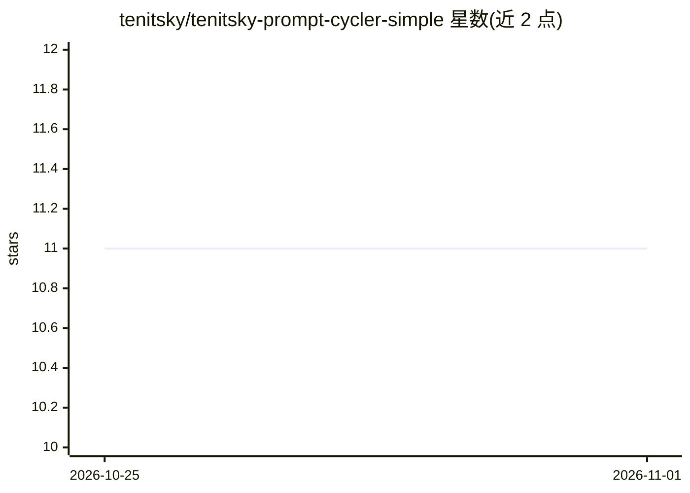

# tenitsky/tenitsky-prompt-cycler-simple

⭐ 11 · Python · MIT · 推送 2026-10-24 · [GitHub](https://github.com/tenitsky/tenitsky-prompt-cycler-simple) · [官网](https://tenitsky.com/guides/prompt-cycler-comfyui-node/) · 个人维护

**ComfyUI 自定义节点：批量生成时循环切换提示词**

为 ComfyUI 提供的自定义节点 Prompt Cycler：每次排队工作流时按顺序或随机方式循环输出列表中的下一条提示词，支持无限数量的自定义提示词（逐行输入），内置 10 条示例提示词，提供循环计数重置与种子控制以复现结果，输出当前提示词与循环索引。适用于文生图批量生成中每张图使用不同提示词的场景。安装方式为 git clone 到 custom_nodes 目录或手动下载解压，并 pip 安装依赖后重启 ComfyUI。

## 筛选速览

| 维度 | 判定 | 备注 |
|---|---|---|
| AI 角色 | `ai-ecosystem` | LLM/agent 周边工具 |
| 许可风险 | `permissive` | MIT |
| 部署形态 | `library` | 以包/库形式分发 |
| 模型依赖 | — | README 未给出锁定关系 |
| 硬件要求 | — | 无带数字的原话,不猜 |
| 安装摩擦 | `low` | 无编译、无系统依赖或容器化 |
| 成熟度 | — | 结构信号不足 |

## 能力要点

- 顺序/随机两种循环模式，支持无限数量自定义提示词
- 种子控制与循环计数重置，支持可复现结果
- 内置 10 条示例提示词
- 输出 prompt 与 cycle_index（从 0 计数）

## 适用场景

- 批量文生图时让每张图使用不同提示词
- 希望以固定种子复现某轮提示词序列
- 配合批处理节点做多提示词高效生成

## 场景标签

`提示工程` · 领域:Agent 开发

## 证据(README 行号)

> L1: # ComfyUI Prompt Cycler Node
> L5: A custom ComfyUI node that cycles through an infinite number of prompts, perfect for batch generation with varied co
> L41: 1. Add the "Prompt Cycler" node to your workflow

## 星数曲线

2026-10-25 11 → 2026-11-01 11（+0）

---
*卡片 v1 · prompt 1.4 · 生成 2026-11-01 · 置信度 mid · 依据 README sha `b26efffc193c` · [字段定义](../../DATASET.md)*
