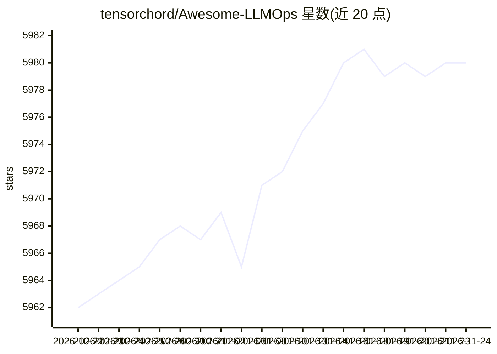

# tensorchord/Awesome-LLMOps

⭐ 5,980 · Shell · CC0-1.0 · 推送 2026-11-16 · [GitHub](https://github.com/tensorchord/Awesome-LLMOps) · 组织维护

**面向开发者的 LLMOps 工具策展清单**

按 LLMOps 全生命周期组织的开源工具目录，覆盖模型（LLM、CV/音频/机器人基础模型）、推理服务（serving 框架、AI 网关、Kubernetes operator）等类别，每条为名称+简介+仓库链接的表格条目，并附 Discord 社区与贡献指南。清单性质决定其不含安装与运行说明；内容为第三方项目的转述，部分条目标注已归档状态。

## 筛选速览

| 维度 | 判定 | 备注 |
|---|---|---|
| AI 角色 | `ai-knowledge` | 知识聚合/清单类 |
| 许可风险 | `viral` | CC0-1.0 |
| 部署形态 | `library` | 以包/库形式分发 |
| 模型依赖 | — | README 未给出锁定关系 |
| 硬件要求 | — | 无带数字的原话,不猜 |
| 安装摩擦 | `medium` | 含编译或系统依赖之一 |
| 成熟度 | — | 结构信号不足 |

## 能力要点

- 按 Model/Serving 等生命周期类别组织的表格化条目
- 覆盖 LLM、CV、音频、机器人 VLA 等基础模型条目
- 收录推理引擎、AI 网关与 K8s operator 类服务工具
- 提供 Discord 社区与贡献指南

## 适用场景

- 查找某类 LLMOps 环节（推理服务、网关等）的开源工具
- 调研开源大模型与 VLA 模型的生态分布
- 按清单链接进入各项目仓库深入了解

## 场景标签

`精选清单` · 领域:学习与行业

## 证据(README 行号)

> L1: # Awesome LLMOps
> L5: An awesome & curated list of the best LLMOps tools for developers.
> L10: ## Table of Contents

## 星数曲线

2026-10-22 5,962 → 2026-11-24 5,980（+18）

---
*卡片 v1 · prompt 1.4 · 生成 2026-11-22 · 置信度 mid · 依据 README sha `e5e2f12e2619` · [字段定义](../../DATASET.md)*
