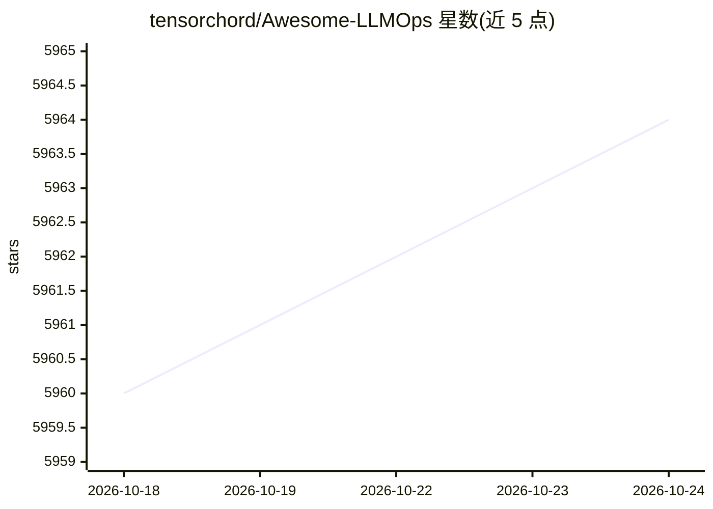

# tensorchord/Awesome-LLMOps

⭐ 5,964 · Shell · CC0-1.0 · 推送 2026-10-16 · [GitHub](https://github.com/tensorchord/Awesome-LLMOps) · 组织维护

**面向开发者的 LLMOps 工具策展清单**

由 TensorChord 维护的 LLMOps 工具聚合清单：按模型（LLM、CV、音频、机器人基础模型）、推理服务、服务框架等章节组织，条目以表格形式列出项目名称、简介与仓库链接，覆盖 Llama.cpp、Ollama、vLLM 等推理运行时以及 BentoML、Jina 等服务框架。README 本身不含安装或运行内容，接受社区按贡献指南提交条目。

## 筛选速览

| 维度 | 判定 | 备注 |
|---|---|---|
| AI 角色 | `ai-knowledge` | 知识聚合/清单类 |
| 许可风险 | `viral` | CC0-1.0 |
| 部署形态 | `library` | 以包/库形式分发 |
| 模型依赖 | — | README 未给出锁定关系 |
| 硬件要求 | — | 无带数字的原话,不猜 |
| 安装摩擦 | `medium` | 含编译或系统依赖之一 |
| 成熟度 | — | 结构信号不足 |

## 能力要点

- 按 Model/Serving/Frameworks 等章节分类组织工具条目
- 覆盖 LLM、CV、音频、机器人四类基础模型条目
- 收录 llama.cpp、Ollama、vLLM 等本地运行时与推理引擎
- 条目以表格呈现项目简介与仓库链接

## 适用场景

- 为 LLM 项目选型时查找推理与服务工具
- 了解 LLMOps 生态中各环节的开源项目分布
- 按类别浏览机器人 VLA 模型与本地推理方案

## 场景标签

`精选清单` · 领域:学习与行业

## 证据(README 行号)

> L5: An awesome & curated list of the best LLMOps tools for developers.
> L10: ## Table of Contents

## 星数曲线

2026-10-18 5,960 → 2026-10-24 5,964（+4）

---
*卡片 v1 · prompt 1.4 · 生成 2026-10-20 · 置信度 mid · 依据 README sha `2957bcbc0cdf` · [字段定义](../../DATASET.md)*
