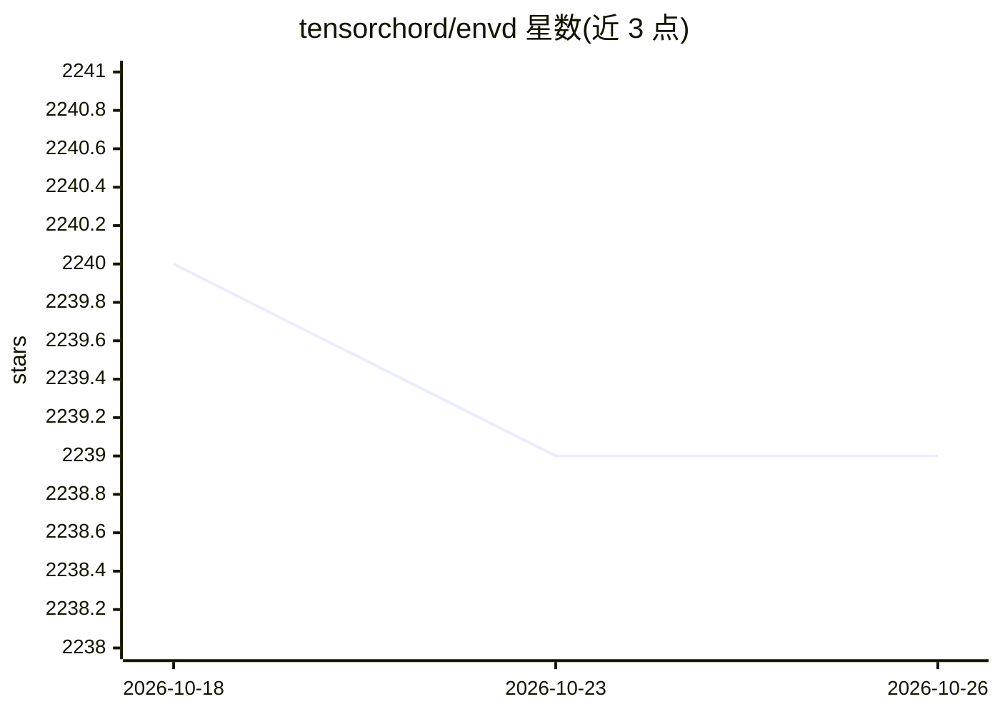

# tensorchord/envd

⭐ 2,239 · Go · Apache-2.0 · 推送 2026-10-02 · [GitHub](https://github.com/tensorchord/envd) · [官网](https://envd.tensorchord.ai/) · 组织维护 · 中文 README

**为 AI/ML 开发者声明式构建容器化开发环境的 CLI 工具**

envd 是一个命令行工具，面向 AI/ML 开发者，用 build.envd 文件声明 Python/conda 等依赖，一条 `envd up` 命令生成基于 buildkit 的隔离容器环境，用于训练、微调或部署。产出镜像兼容 OCI 规范，可推送到 Harbor、Docker Hub 等镜像仓库；支持本地与 Kubernetes 集群上下文切换、远程构建、PyPI/APT 缓存复用，并可通过 include 复用 Git 仓库中的构建函数。v1.0 起默认 v1 语法与 moby-worker 构建器。要求 Docker 20.10.0 以上，通过 pip 安装二进制并运行 `envd bootstrap` 初始化。

## 筛选速览

| 维度 | 判定 | 备注 |
|---|---|---|
| AI 角色 | `ai-ecosystem` | LLM/agent 周边工具 |
| 许可风险 | `permissive` | Apache-2.0 |
| 部署形态 | `self-host` | docker 或自建部署 |
| 模型依赖 | — | README 未给出锁定关系 |
| 硬件要求 | — | 无带数字的原话,不猜 |
| 安装摩擦 | `low` | 无编译、无系统依赖或容器化 |
| 成熟度 | — | 结构信号不足 |

## 能力要点

- build.envd 声明式定义依赖，`envd up` 一条命令构建容器环境
- 镜像兼容 OCI 规范，可推送 Harbor/Docker Hub 并支持 Kubernetes 上下文
- buildkit 支持 PyPI/APT 缓存与远程构建
- include 函数从 Git 仓库导入构建函数实现团队复用

## 适用场景

- 为 ML 训练/微调/推理项目搭建可复现的容器环境
- 在资源受限本机上将构建任务放到远程机器执行
- 团队沉淀共享构建函数，避免复制粘贴 Dockerfile

## 场景标签

`MLOps` · 领域:训练与推理

## 证据(README 行号)

> L16: envd (`ɪnˈvdɪ`) is a command-line tool that helps you create the container-based development environment for AI/ML.
> L39: With `envd`, users can create an isolated space to train, fine-tune, or serve. By utilizing sophisticated virtualiz
> L45: `envd` can now be used on a hybrid platform, ranging from local machines to clusters hosted by Kubernetes. Any of t

## 星数曲线

2026-10-18 2,240 → 2026-10-26 2,239（-1）

---
*卡片 v1 · prompt 1.4 · 生成 2026-10-21 · 置信度 mid · 依据 README sha `9fc4cb765df6` · [字段定义](../../DATASET.md)*
