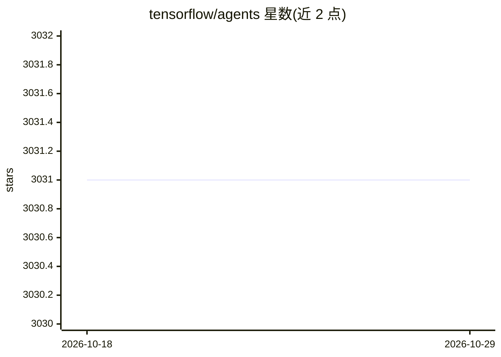

# tensorflow/agents

⭐ 3,031 · Python · Apache-2.0 · 推送 2026-01-16 · [GitHub](https://github.com/tensorflow/agents) · 组织维护

**面向开发者的 TensorFlow 强化学习与 Contextual Bandits 库**

基于 TensorFlow 的强化学习（RL）与多臂老虎机（Bandits）算法库，以模块化 Agent 组件形式提供 DQN、DDQN、DDPG、TD3、REINFORCE、PPO、SAC 等算法实现，每个 Agent 定义与环境交互的 Policy 及其训练方式。提供 Colab 教程、端到端训练示例与完整 Bandits 套件（环境与代理）。通过 pip 安装稳定版或 nightly 版本，亦可从 GitHub 克隆源码安装；注意使用 Reverb 回放缓冲区时仅支持 Linux。项目标注处于活跃开发中，接口可能随时变更。

## 筛选速览

| 维度 | 判定 | 备注 |
|---|---|---|
| AI 角色 | `ai-native` | 本体是模型或模型工具 |
| 许可风险 | `permissive` | Apache-2.0 |
| 部署形态 | `library` | 以包/库形式分发 |
| 模型依赖 | — | README 未给出锁定关系 |
| 硬件要求 | — | 无带数字的原话,不猜 |
| 安装摩擦 | `low` | 无编译、无系统依赖或容器化 |
| 成熟度 | `idea` | |

## 能力要点

- 模块化 Agent 组件实现 7 种主流 RL 算法（DQN/PPO/SAC/TD3 等）
- 完整 Multi-Armed Bandits 套件（环境与代理，RL 代理也可用于 Bandit 环境）
- 提供 Colab 教程与端到端训练示例
- 发布稳定版与 nightly 版本，附版本-TensorFlow 对应表

## 适用场景

- 实现和训练新的强化学习或 Bandits 算法
- 在 Cartpole 等环境中快速上手 DQN 训练
- 对 RL 算法组件做测试集成与基准测试

## 场景标签

`强化学习` · 领域:训练与推理

## 证据(README 行号)

> L6: TF-Agents makes implementing, deploying,
> L32: * [DQN: __Human level control through deep reinforcement learning__ Mnih et

## 星数曲线

2026-10-18 3,031 → 2026-10-29 3,031（+0）

---
*卡片 v1 · prompt 1.4 · 生成 2026-10-20 · 置信度 high · 依据 README sha `197619fa90b4` · [字段定义](../../DATASET.md)*
