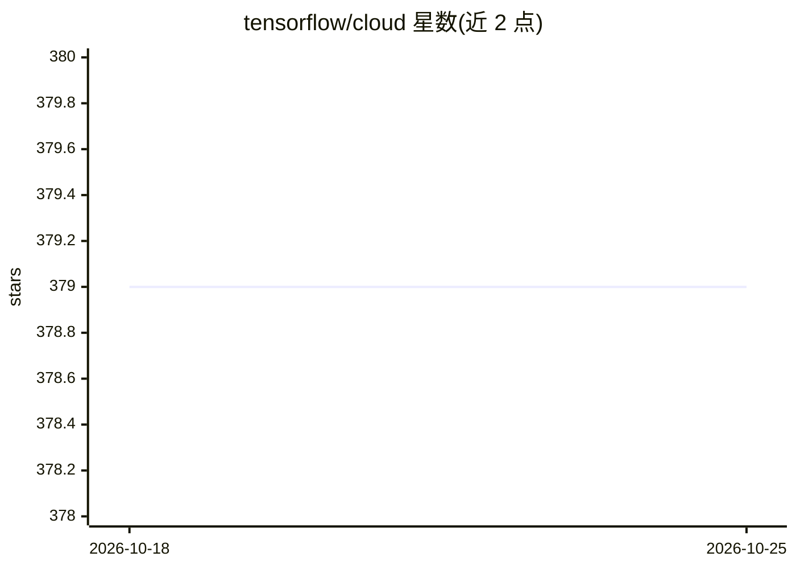

# tensorflow/cloud

⭐ 379 · Python · Apache-2.0 · 推送 2026-10-06 · [GitHub](https://github.com/tensorflow/cloud) · [官网](https://github.com/tensorflow/cloud) · 组织维护

**把本地 Keras/TF 训练代码一键转为 GCP 分布式云训练的 API**

TensorFlow 官方仓库（已声明 DEPRECATED）提供的 Python API：通过 run API 将本地调试过的 Keras/TensorFlow 训练脚本或 notebook 打包为 Docker 镜像，部署到 Google Cloud（AI Platform）并自动套用 TensorFlow 分布式策略（OneDevice/Mirrored/MultiWorkerMirrored/TPU 等），支持流式日志与 TensorBoard 监控；另含 TensorFlow Cloud Tuner 做云上超参调优。面向已有 GCP 账号与项目的开发者，需要 Python>=3.6、GCP 项目及 Docker 或 Cloud Build。注意：TPUStrategy 仅支持 TF 2.1。

## 筛选速览

| 维度 | 判定 | 备注 |
|---|---|---|
| AI 角色 | `ai-ecosystem` | LLM/agent 周边工具 |
| 许可风险 | `permissive` | Apache-2.0 |
| 部署形态 | `library` | 以包/库形式分发 |
| 模型依赖 | — | README 未给出锁定关系 |
| 硬件要求 | — | 无带数字的原话,不猜 |
| 安装摩擦 | `low` | 无编译、无系统依赖或容器化 |
| 成熟度 | — | 结构信号不足 |

## 能力要点

- tfc.run 一行调用即可把 entry_point 脚本/notebook 提交到 GCP 训练
- 自动打包 Docker 镜像并按集群配置套用 TensorFlow 分布式策略
- 支持 CPU/GPU（T4/V100）/TPU 多种机型配置与多 worker 训练
- 日志流式传输与托管 TensorBoard 监控、checkpoint 存储

## 适用场景

- 本地小数据调试后无缝扩展到云端大规模分布式训练
- 把 Keras notebook 直接提交到 GCP 做调参和训练
- 使用 V100 多卡或 TPU worker 配置跑 MultiWorkerMirrored/TPU 训练

## 场景标签

`模型训练` `MLOps` · 领域:训练与推理

## 证据(README 行号)

> L3: The TensorFlow Cloud repository provides APIs that will allow to easily go from
> L57: TensorFlow Cloud package provides the `run` API for training your models on GCP.

## 星数曲线

2026-10-18 379 → 2026-10-25 379（+0）

---
*卡片 v1 · prompt 1.4 · 生成 2026-10-21 · 置信度 high · 依据 README sha `6cb4615a0126` · [字段定义](../../DATASET.md)*
