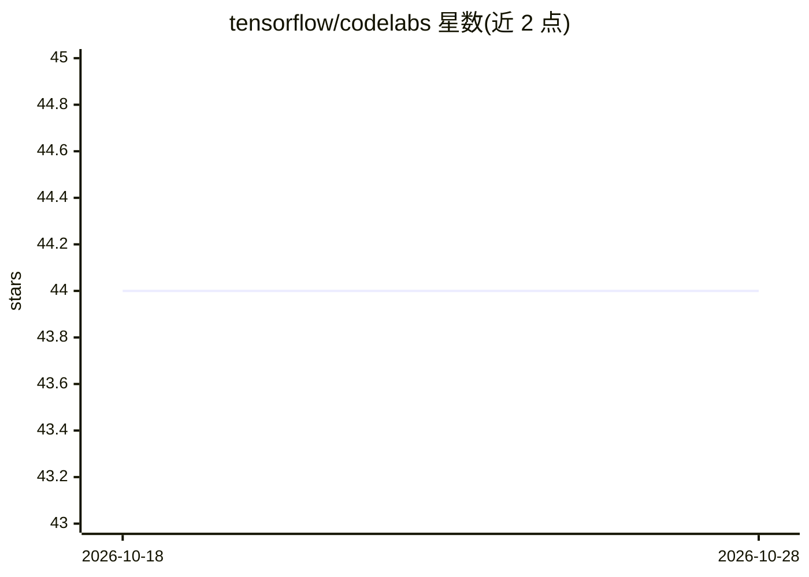

# tensorflow/codelabs

⭐ 44 · Jupyter Notebook · Apache-2.0 · 推送 2026-03-28 · [GitHub](https://github.com/tensorflow/codelabs) · 组织维护

**TensorFlow 官方 codelab 示例代码仓库，供学习实践**

TensorFlow 官方仓库，收录多个 TensorFlow codelab（实操教程）的配套示例代码，并链接 Google 机器学习学习路径（ML pathways）供进一步学习。定位是教程样例集合而非可安装的库或应用；README 极简，未提供安装命令、运行方式或依赖说明，具体内容由各 codelab 目录承载。适合跟随 Google 教程学习 TensorFlow 的开发者和学习者查阅对应代码。

## 筛选速览

| 维度 | 判定 | 备注 |
|---|---|---|
| AI 角色 | `ai-knowledge` | 知识聚合/清单类 |
| 许可风险 | `permissive` | Apache-2.0 |
| 部署形态 | `None` |  |
| 模型依赖 | — | README 未给出锁定关系 |
| 硬件要求 | — | 无带数字的原话,不猜 |
| 安装摩擦 | `low` | 无编译、无系统依赖或容器化 |
| 成熟度 | — | 结构信号不足 |

## 能力要点

- 收录多个 TensorFlow codelab 的示例代码
- 指向 Google 机器学习学习路径页面

## 适用场景

- 跟随 TensorFlow codelab 教程时获取配套示例代码
- 查阅官方教程样例作为学习参考

## 场景标签

`教程课程` · 领域:学习与行业

## 证据(README 行号)

> L1: # TensorFlow Codelabs
> L3: This repository contains sample code for several TensorFlow codelabs. Check out the Google machine learning pathways

## 星数曲线

2026-10-18 44 → 2026-10-28 44（+0）

---
*卡片 v1 · prompt 1.4 · 生成 2026-10-25 · 置信度 mid · 依据 README sha `96beef83d4e8` · [字段定义](../../DATASET.md)*
