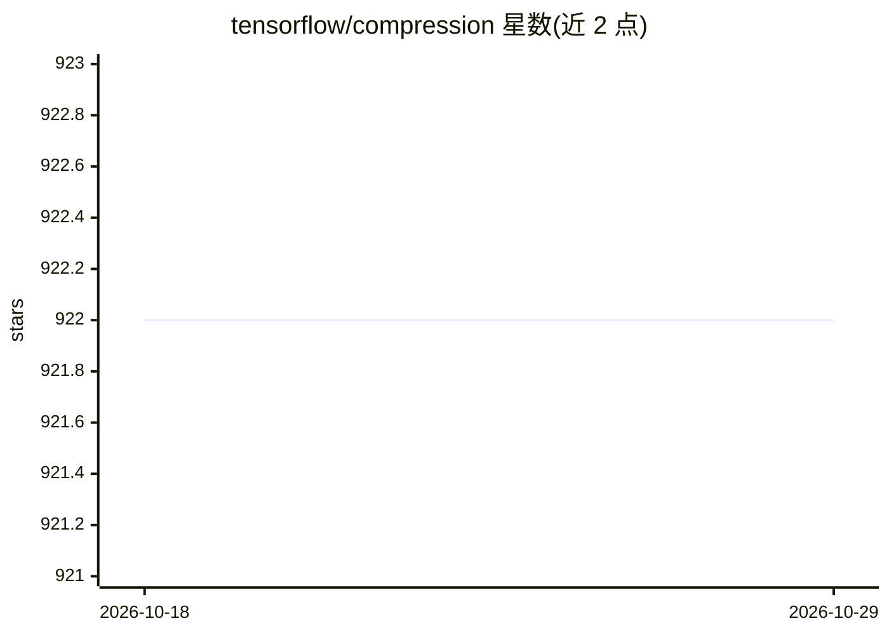

# tensorflow/compression

⭐ 922 · Python · Apache-2.0 · 推送 2026-04-17 · [GitHub](https://github.com/tensorflow/compression) · 组织维护

**TensorFlow 的机器学习数据压缩工具库，构建端到端优化压缩模型**

Google TensorFlow 团队维护的 Python 库，提供 C++ 实现的 range coding（算术编码）TF 算子、熵模型类（训练期充当似然模型、训练后自动编码张量为优化比特序列）及 GDN 等压缩相关 Keras 层。面向构建学习型数据压缩（如图像压缩）模型的开发者与研究者；附带 tfci.py 预训练模型脚本与已发表论文的实现。重要限制：2024 年 2 月起进入维护模式，功能冻结，新包仅支持 TF 2.14，ops 包最高支持 TF 2.18。

## 筛选速览

| 维度 | 判定 | 备注 |
|---|---|---|
| AI 角色 | `ai-native` | 本体是模型或模型工具 |
| 许可风险 | `permissive` | Apache-2.0 |
| 部署形态 | `self-host` | docker 或自建部署 |
| 模型依赖 | — | README 未给出锁定关系 |
| 硬件要求 | — | 无带数字的原话,不猜 |
| 安装摩擦 | `low` | 无编译、无系统依赖或容器化 |
| 成熟度 | — | 结构信号不足 |

## 能力要点

- C++ 实现的 range coding TF 算子（含 Elias gamma 溢出编码）
- 熵模型类：训练期似然模型、训练后自动生成 range coding 表并编码
- tfci.py 用预训练模型压缩/解压图像（PNG↔TFCI）
- models 目录含多篇已发表论文的模型实现可用于训练

## 适用场景

- 训练自己的端到端优化图像压缩模型
- 用预训练模型直接压缩与解压图片
- 研究率失真优化编码与非线性变换编码

## 场景标签

 · 领域:机器学习/数据压缩

## 证据(README 行号)

> L3: TensorFlow Compression (TFC) contains data compression tools for TensorFlow.
> L5: You can use this library to build your own ML models with end-to-end optimized
> L30: - Entropy model classes which simplify the process of designing rate–distortion

## 星数曲线

2026-10-18 922 → 2026-10-29 922（+0）

---
*卡片 v1 · prompt 1.4 · 生成 2026-10-21 · 置信度 mid · 依据 README sha `58a7dbf18582` · [字段定义](../../DATASET.md)*
