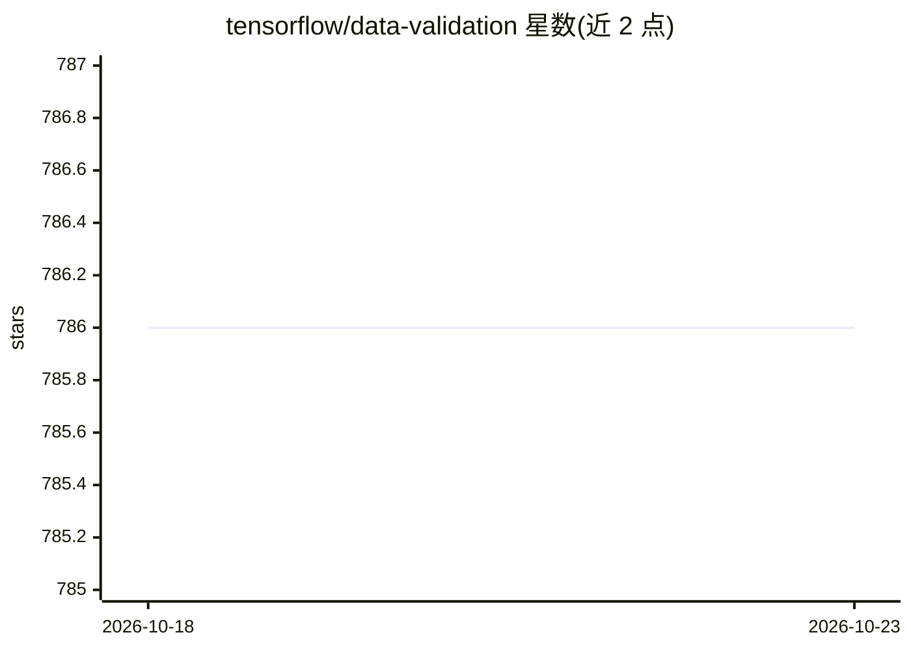

# tensorflow/data-validation

⭐ 786 · Python · Apache-2.0 · 推送 2026-08-14 · [GitHub](https://github.com/tensorflow/data-validation) · 组织维护

**机器学习数据的统计探索与数据校验 Python 库**

TensorFlow Data Validation (TFDV) 是面向机器学习数据管线的探索与校验库：计算训练/测试数据的汇总统计，自动生成数据 schema（描述必需值、取值范围、词表等期望），检测缺失特征、越界值、特征类型错误等异常，并配套统计/Facets 对比查看器、schema 查看器与异常查看器。基于 Apache Beam 支持分布式计算，设计上与 TensorFlow 及 TFX 配合使用。通过 PyPI 安装，或经 Docker/源码构建 wheel。

## 筛选速览

| 维度 | 判定 | 备注 |
|---|---|---|
| AI 角色 | `ai-ecosystem` | LLM/agent 周边工具 |
| 许可风险 | `permissive` | Apache-2.0 |
| 部署形态 | `self-host` | docker 或自建部署 |
| 模型依赖 | — | README 未给出锁定关系 |
| 硬件要求 | — | 无带数字的原话,不猜 |
| 安装摩擦 | `low` | 无编译、无系统依赖或容器化 |
| 成熟度 | — | 结构信号不足 |

## 能力要点

- 训练/测试数据的可扩展汇总统计计算
- 自动生成数据 schema 并支持 schema 查看
- 异常检测：缺失特征、越界值、错误特征类型
- 基于 Apache Beam，本地或分布式（如 Cloud Dataflow）运行

## 适用场景

- 在训练前校验数据分布与 schema 是否符合预期
- 对比训练与测试数据的特征分布差异
- 在 TFX 流水线中做数据质量检查

## 场景标签

 · 领域:机器学习基础设施/数据工程

## 证据(README 行号)

> L7: *TensorFlow Data Validation* (TFDV) is a library for exploring and validating
> L8: machine learning data. It is designed to be highly scalable
> L20: * Anomaly detection to identify anomalies,

## 星数曲线

2026-10-18 786 → 2026-10-23 786（+0）

---
*卡片 v1 · prompt 1.4 · 生成 2026-10-21 · 置信度 high · 依据 README sha `caad5f2e0c3e` · [字段定义](../../DATASET.md)*
