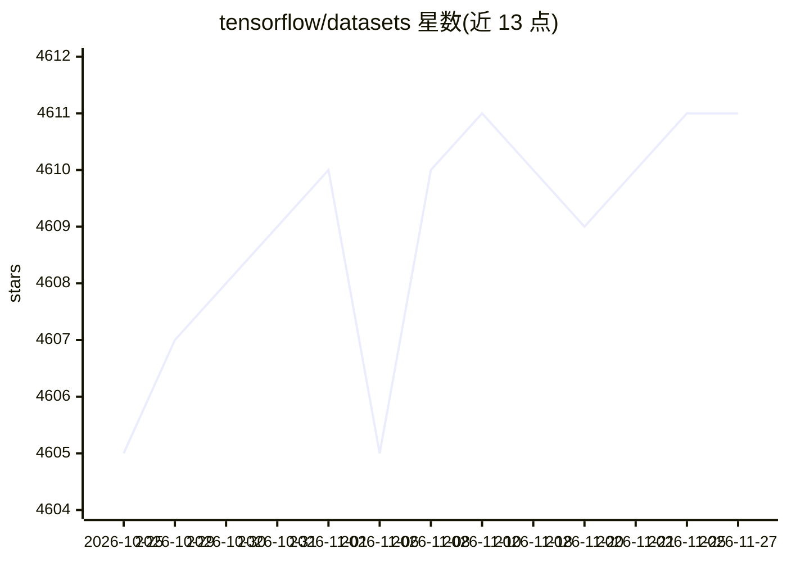

# tensorflow/datasets

⭐ 4,611 · Python · Apache-2.0 · 推送 2026-11-13 · [GitHub](https://github.com/tensorflow/datasets) · [官网](https://www.tensorflow.org/datasets) · 组织维护

**面向 TensorFlow/JAX 用户的公开数据集集合库**

TFDS 将大量公开数据集整理为开箱即用的 tf.data.Dataset 格式，支持确定性顺序与可复现样本输出，并提供细粒度控制选项。库本身不托管数据集，只负责下载与准备，许可责任由使用者自行判断。通过 pip 安装，提供教程、API 参考与数据集目录文档，可在 Colab 中交互式试用。

## 筛选速览

| 维度 | 判定 | 备注 |
|---|---|---|
| AI 角色 | `ai-knowledge` | 知识聚合/清单类 |
| 许可风险 | `permissive` | Apache-2.0 |
| 部署形态 | `library` | 以包/库形式分发 |
| 模型依赖 | — | README 未给出锁定关系 |
| 硬件要求 | — | 无带数字的原话,不猜 |
| 安装摩擦 | `low` | 无编译、无系统依赖或容器化 |
| 成熟度 | — | 结构信号不足 |

## 能力要点

- 以 tf.data.Dataset 格式提供公开数据集
- 同顺序确定性输出，保证可复现性
- 提供添加自定义数据集的指南与数据集请求机制

## 适用场景

- 为 TensorFlow/JAX 训练管线快速加载公开数据集
- 需要可复现的数据准备流程时
- 为 ML 社区贡献并收录新数据集

## 场景标签

 · 领域:机器学习/数据集工具

## 证据(README 行号)

> L3: TensorFlow Datasets provides many public datasets as `tf.data.Datasets`.
> L22: * List of all available datasets
> L26: # !pip install tensorflow-datasets

## 星数曲线

2026-10-25 4,605 → 2026-11-27 4,611（+6）

---
*卡片 v1 · prompt 1.4 · 生成 2026-11-22 · 置信度 high · 依据 README sha `5357b6a1ddad` · [字段定义](../../DATASET.md)*
