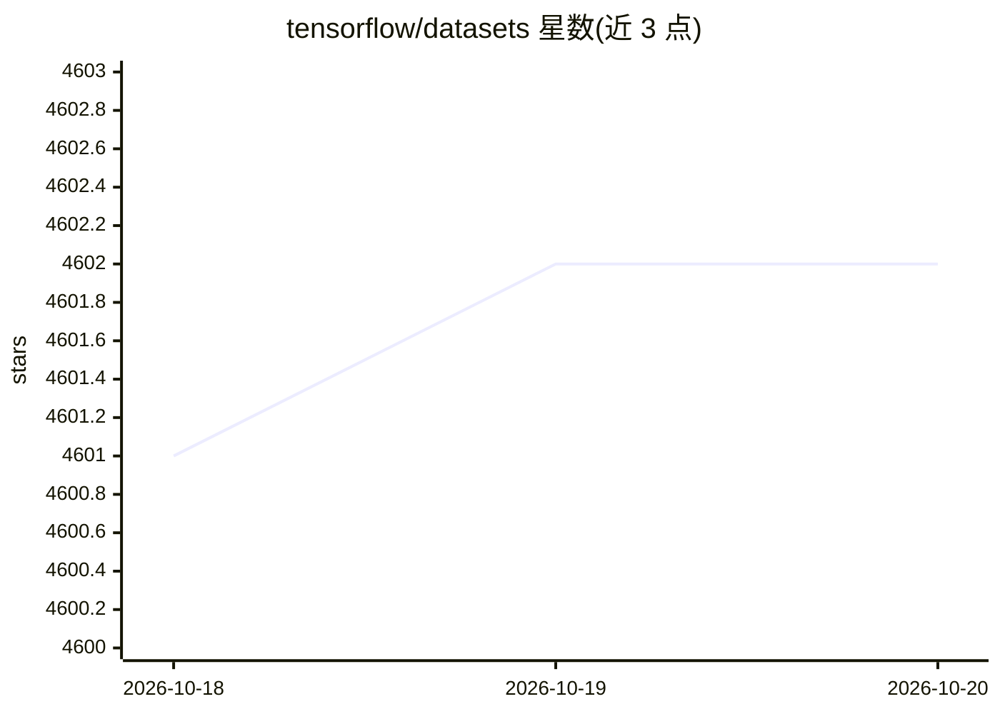

# tensorflow/datasets

⭐ 4,602 · Python · Apache-2.0 · 推送 2026-10-15 · [GitHub](https://github.com/tensorflow/datasets) · [官网](https://www.tensorflow.org/datasets) · 组织维护

**面向 ML 开发者的公共数据集下载与准备库**

TensorFlow 官方团队维护的数据集工具库：将众多公共数据集以 tf.data.Dataset 形式提供，支持 TensorFlow、JAX、NumPy 等生态使用。核心机制包括下载与准备公共数据集、确定性顺序输出保证复现、允许用户按指南添加自定义数据集。库本身不托管或分发数据集，也不为数据集许可背书，使用者需自行确认许可权限。以 pip 包形式安装，要求 Python 3.10+，提供 Colab 交互教程。

## 筛选速览

| 维度 | 判定 | 备注 |
|---|---|---|
| AI 角色 | `ai-knowledge` | 知识聚合/清单类 |
| 许可风险 | `permissive` | Apache-2.0 |
| 部署形态 | `library` | 以包/库形式分发 |
| 模型依赖 | — | README 未给出锁定关系 |
| 硬件要求 | — | 无带数字的原话,不猜 |
| 安装摩擦 | `low` | 无编译、无系统依赖或容器化 |
| 成熟度 | — | 结构信号不足 |

## 能力要点

- 以 tf.data.Dataset 形式提供大量公共数据集
- 兼容 TensorFlow、JAX、NumPy 等生态
- 数据以确定顺序输出，保证所有用户结果可复现
- 提供指南支持用户添加自定义数据集

## 适用场景

- 训练模型时标准化加载公共数据集
- 在 JAX/NumPy 工作流中复用同一数据准备管线
- 为论文实验复现固定数据集版本与顺序

## 场景标签

 · 领域:机器学习/数据工程

## 证据(README 行号)

> L3: TensorFlow Datasets provides many public datasets as `tf.data.Datasets`.
> L7: Python 3.10+

## 星数曲线

2026-10-18 4,601 → 2026-10-20 4,602（+1）

---
*卡片 v1 · prompt 1.4 · 生成 2026-10-20 · 置信度 high · 依据 README sha `173d40c75160` · [字段定义](../../DATASET.md)*
