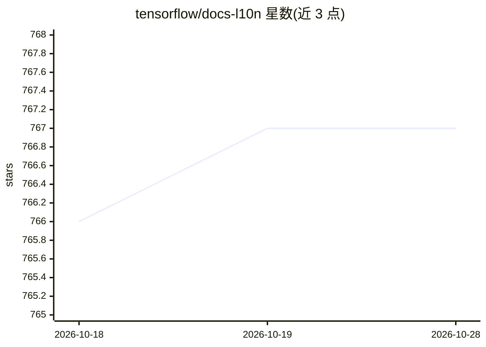

# tensorflow/docs-l10n

⭐ 767 · Jupyter Notebook · Apache-2.0 · 推送 2026-03-11 · [GitHub](https://github.com/tensorflow/docs-l10n) · [官网](https://gitlocalize.com/tensorflow/docs-l10n) · 组织维护

**tensorflow.org 文档与教程的多语言翻译项目**

TensorFlow 官方文档翻译仓库：将 tensorflow.org 发布的技术内容与 Jupyter 笔记本翻译为多种语言，源内容聚合自多个 GitHub 仓库到 /site/en-snapshot/ 目录。翻译通过 GitLocalize 项目进行，定期（通常每 1-2 周）发布到网站；无人工翻译的页面回退到机器翻译并带横幅标识。API 参考、旧版本、图片与安装说明等不翻译。官方语言按站点指标与社区支持等因子决定，社区分支存放非官方支持语言的存档内容。面向文档贡献者与 TensorFlow 用户。

## 筛选速览

| 维度 | 判定 | 备注 |
|---|---|---|
| AI 角色 | `ai-knowledge` | 知识聚合/清单类 |
| 许可风险 | `permissive` | Apache-2.0 |
| 部署形态 | `None` |  |
| 模型依赖 | — | README 未给出锁定关系 |
| 硬件要求 | — | 无带数字的原话,不猜 |
| 安装摩擦 | `low` | 无编译、无系统依赖或容器化 |
| 成熟度 | — | 结构信号不足 |

## 能力要点

- 聚合多仓库源内容用于多语言翻译
- GitLocalize 集成与机器翻译回退机制
- 官方语言与社区分支（community branch）双层结构
- Apache 2.0 许可

## 适用场景

- 阅读 tensorflow.org 上非英文版本的教程与文档
- 为 TensorFlow 文档贡献自己语言的翻译
- fork 社区分支以维护未被官方支持的语言文档

## 场景标签

`教程课程` · 领域:学习与行业

## 证据(README 行号)

> L3: This project contains translations of the technical content and Jupyter
> L4: notebooks published on tensorflow.org.

## 星数曲线

2026-10-18 766 → 2026-10-28 767（+1）

---
*卡片 v1 · prompt 1.4 · 生成 2026-10-21 · 置信度 high · 依据 README sha `a3b21b752fcf` · [字段定义](../../DATASET.md)*
