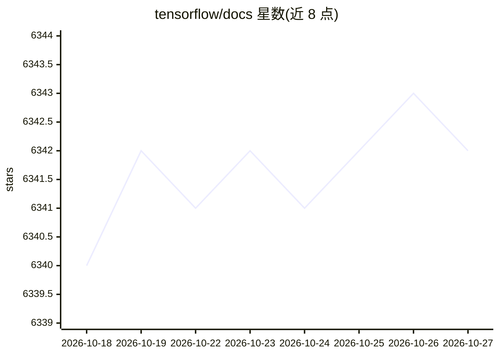

# tensorflow/docs

⭐ 6,342 · Jupyter Notebook · Apache-2.0 · 推送 2026-10-20 · [GitHub](https://github.com/tensorflow/docs) · [官网](https://www.tensorflow.org) · 组织维护

**TensorFlow 官方指南与教程文档的源文件仓库**

存放 tensorflow.org 网站上指南与教程的文档源文件，供读者查阅和社区贡献。贡献流程为阅读 CONTRIBUTING.md、贡献者指南与风格指南后提交 PR；文档 issue 需到 tensorflow/tensorflow 主仓库的 issue tracker 提交。社区翻译以 best-effort 方式在 tensorflow/docs-l10n 仓库维护，译者与审阅者按语言加入邮件列表并提交 PR。仓库以 Apache License 2.0 授权。

## 筛选速览

| 维度 | 判定 | 备注 |
|---|---|---|
| AI 角色 | `ai-knowledge` | 知识聚合/清单类 |
| 许可风险 | `permissive` | Apache-2.0 |
| 部署形态 | `None` |  |
| 模型依赖 | — | README 未给出锁定关系 |
| 硬件要求 | — | 无带数字的原话,不猜 |
| 安装摩擦 | `low` | 无编译、无系统依赖或容器化 |
| 成熟度 | — | 结构信号不足 |

## 能力要点

- tensorflow.org 指南与教程的文档源文件
- 社区翻译在 tensorflow/docs-l10n 仓库以 best-effort 方式维护
- 通过 CONTRIBUTING.md 与风格指南定义贡献流程

## 适用场景

- 查阅或本地构建 TensorFlow 官方文档
- 以译者或审阅者身份参与多语言文档翻译
- 为 TensorFlow 文档提交修改或报 issue

## 场景标签

`教程课程` · 领域:学习与行业

## 证据(README 行号)

> L3: These are the source files for the guide and tutorials on
> L4: tensorflow.org.

## 星数曲线

2026-10-18 6,340 → 2026-10-27 6,342（+2）

---
*卡片 v1 · prompt 1.4 · 生成 2026-10-20 · 置信度 high · 依据 README sha `0cc522cbf718` · [字段定义](../../DATASET.md)*
