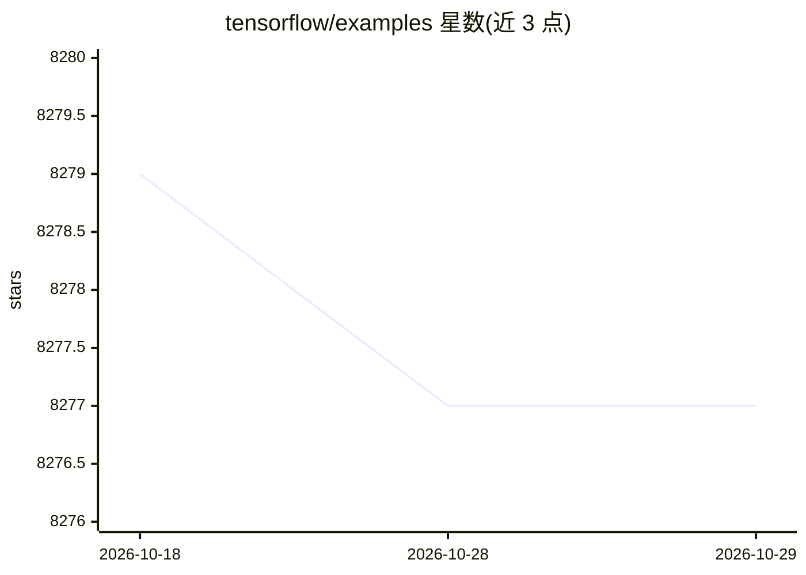

# tensorflow/examples

⭐ 8,277 · Jupyter Notebook · Apache-2.0 · 推送 2026-10-05 · [GitHub](https://github.com/tensorflow/examples) · [官网](https://www.tensorflow.org) · 组织维护

**TensorFlow 官方示例与课程教材仓库，供学习者参考**

TensorFlow 官方维护的示例仓库，收录多类材料：社区示例展示、TensorFlow.org 上引用的示例、官方课程（如 Udacity 深度学习课）配套教材，以及 TensorFlow 博客与 YouTube 频道的支持材料。README 指向核心文档与 Colab 可运行 notebook 作为主要学习入口，欢迎社区贡献，问题需提交到 tensorflow/tensorflow 仓库的 tracker。采用 Apache License 2.0。

## 筛选速览

| 维度 | 判定 | 备注 |
|---|---|---|
| AI 角色 | `ai-knowledge` | 知识聚合/清单类 |
| 许可风险 | `permissive` | Apache-2.0 |
| 部署形态 | `None` |  |
| 模型依赖 | — | README 未给出锁定关系 |
| 硬件要求 | — | 无带数字的原话,不猜 |
| 安装摩擦 | `low` | 无编译、无系统依赖或容器化 |
| 成熟度 | — | 结构信号不足 |

## 能力要点

- 收录社区示例与 TensorFlow.org 引用的示例
- 提供 Udacity 深度学习课程配套材料
- 支撑 TensorFlow 博客与 YouTube 频道内容

## 适用场景

- 学习 TensorFlow 时查找官方示例代码
- 参加 Udacity 深度学习课程获取配套教材
- 查找 TensorFlow 博客/视频对应的支持材料

## 场景标签

`教程课程` · 领域:学习与行业

## 证据(README 行号)

> L16: This is the TensorFlow example repo. It has several classes of material:
> L20: * Publish material supporting official TensorFlow courses

## 星数曲线

2026-10-18 8,279 → 2026-10-29 8,277（-2）

---
*卡片 v1 · prompt 1.4 · 生成 2026-10-20 · 置信度 high · 依据 README sha `3dd867dc5a7b` · [字段定义](../../DATASET.md)*
