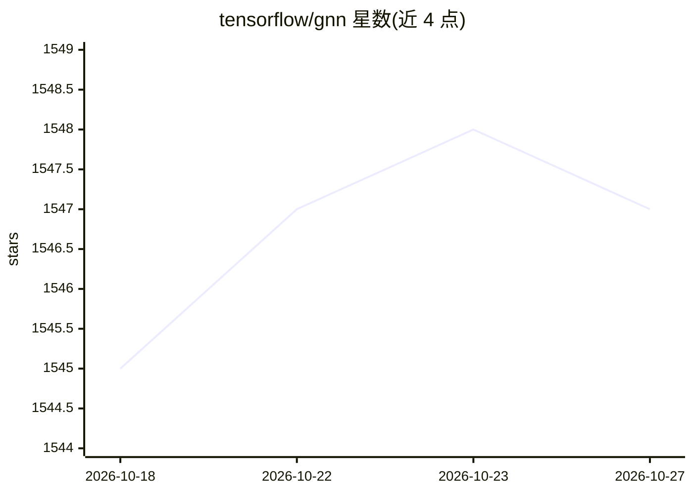

# tensorflow/gnn

⭐ 1,547 · Python · Apache-2.0 · 推送 2026-10-26 · [GitHub](https://github.com/tensorflow/gnn) · 组织维护

**在 TensorFlow 上构建图神经网络（GNN）的库**

TensorFlow GNN 提供构建图神经网络所需的组件：GraphTensor 类型支持多类型节点/边的异构图表示；图采样工具可将大规模数据库转为训练/推理用的子图流；附带可直接使用的模型与 Keras 层，以及训练编排的高层 API。该库是 Google 内部库的开源移植，在 Linux 上开发与测试。要求 TensorFlow 2.12+ 且仅兼容 Keras v2（TF2.16+ 需另装 tf-keras 并设置 TF_USE_LEGACY_KERAS=1），分布式图采样依赖 Apache Beam。

## 筛选速览

| 维度 | 判定 | 备注 |
|---|---|---|
| AI 角色 | `ai-native` | 本体是模型或模型工具 |
| 许可风险 | `permissive` | Apache-2.0 |
| 部署形态 | `library` | 以包/库形式分发 |
| 模型依赖 | — | README 未给出锁定关系 |
| 硬件要求 | — | 无带数字的原话,不猜 |
| 安装摩擦 | `low` | 无编译、无系统依赖或容器化 |
| 成熟度 | — | 结构信号不足 |

## 能力要点

- GraphTensor 类型表示多类型节点/边的异构图
- 图采样工具将大数据库转为子图流供训练与推理
- 提供现成模型、Keras 层与训练编排高层 API
- Google 内部库的开源移植，附带 TF-GNN 论文

## 适用场景

- 在 TensorFlow 上训练异构图上的 GNN 模型
- 对超大规模图数据采样后做端到端训练
- 在 Colab 中直接运行分子图分类、OGBN-MAG 等示例

## 场景标签

`模型训练` · 领域:训练与推理

## 证据(README 行号)

> L5: TensorFlow GNN is a library to build
> L6: Graph Neural Networks on the TensorFlow platform.
> L16:  * a collection of ready-to-use models

## 星数曲线

2026-10-18 1,545 → 2026-10-27 1,547（+2）

---
*卡片 v1 · prompt 1.4 · 生成 2026-10-21 · 置信度 high · 依据 README sha `de80107ee0f3` · [字段定义](../../DATASET.md)*
