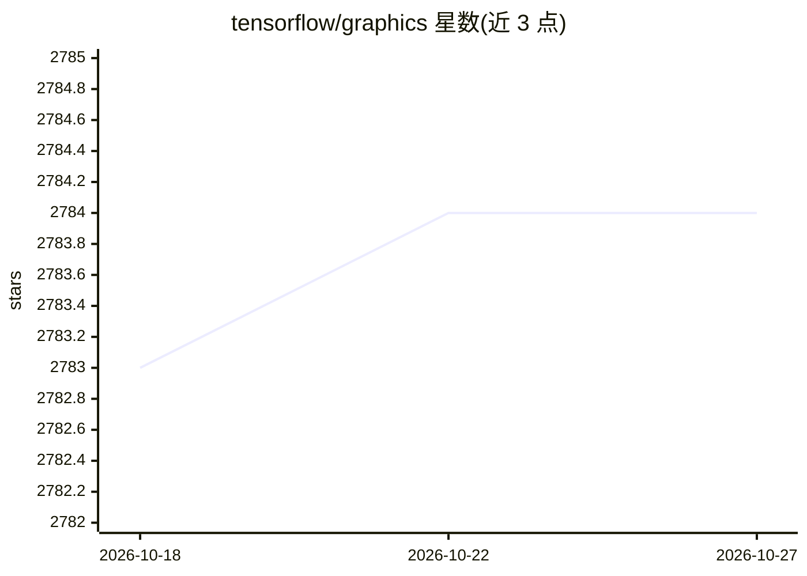

# tensorflow/graphics

⭐ 2,784 · Python · Apache-2.0 · 推送 2026-10-22 · [GitHub](https://github.com/tensorflow/graphics) · 组织维护

**面向 TensorFlow 的可微图形与几何层库：训练 3D 视觉模型**

由 Google 团队开发的 TensorFlow 扩展库，提供可微的图形与几何层（相机模型、反射率模型、空间变换、网格卷积）以及 3D TensorBoard 可视化插件，用于训练和调试涉及 3D 数据的机器学习模型。定位是 analysis-by-synthesis 自监督训练：视觉系统提取场景参数、图形系统据此渲染并比对原图。兼容 TensorFlow 稳定版与 tf-nightly，支持 graph 与 eager 执行；附带按难度分级的 Colab 教程（位姿估计、插值、反射率、球谐渲染、网格分割等）。限制：TensorBoard 3D 插件目前不兼容 eager 执行与 TensorFlow 2；教程不属于 API 可随时变更。

## 筛选速览

| 维度 | 判定 | 备注 |
|---|---|---|
| AI 角色 | `ai-ecosystem` | LLM/agent 周边工具 |
| 许可风险 | `permissive` | Apache-2.0 |
| 部署形态 | `library` | 以包/库形式分发 |
| 模型依赖 | — | README 未给出锁定关系 |
| 硬件要求 | — | 无带数字的原话,不猜 |
| 安装摩擦 | `low` | 无编译、无系统依赖或容器化 |
| 成熟度 | — | 结构信号不足 |

## 能力要点

- 可微相机、反射率、空间变换、网格卷积等图形/几何层
- TensorBoard 3D 插件交互式可视化网格与点云
- 兼容 TensorFlow 稳定版与 tf-nightly，支持 graph/eager 执行
- 提供初级到高级的 Colab 教程（位姿估计、球谐渲染、网格分割等）

## 适用场景

- 以自监督 analysis-by-synthesis 方式训练 3D 视觉模型
- 在神经网络中显式引入几何先验与约束
- 用 3D TensorBoard 对网格/点云实验做可视化调试

## 场景标签

`模型训练` · 领域:训练与推理

## 证据(README 行号)

> L48: and to do so, it provides a set of differentiable graphics and geometry layers
> L50: and 3D viewer functionalities (e.g. 3D TensorBoard) that can be used to train

## 星数曲线

2026-10-18 2,783 → 2026-10-27 2,784（+1）

---
*卡片 v1 · prompt 1.4 · 生成 2026-10-21 · 置信度 high · 依据 README sha `66a0a4c8d04f` · [字段定义](../../DATASET.md)*
