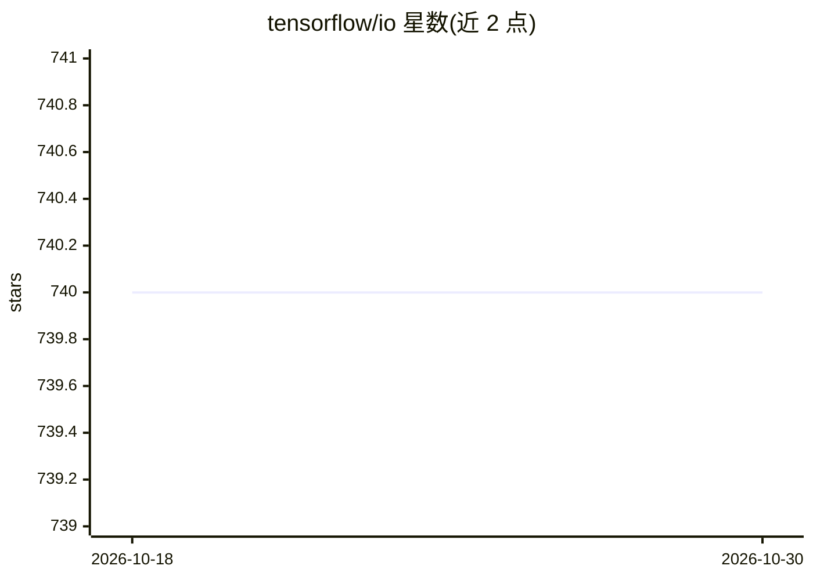

# tensorflow/io

⭐ 740 · C++ · Apache-2.0 · 推送 2026-06-25 · [GitHub](https://github.com/tensorflow/io) · 组织维护

**为 TensorFlow 提供额外文件系统与文件格式扩展的官方 IO 库**

由 TensorFlow SIG-IO 维护的 Python（及 R）扩展包，补充 TensorFlow 内置支持之外的文件系统与文件格式，如 HTTP/HTTPS 直接读取数据集、自动检测并解压 gzip 数据。集成 Kafka、Ignite、Prometheus、Google PubSub、Azure Storage、AWS Kinesis、Alibaba Cloud OSS 等系统，并在 CI 中以真实系统、模拟器或离线方式测试。通过 pip 安装，提供与 TensorFlow 版本一一对应的兼容表，另有 Docker 镜像与 nightly 构建。

## 筛选速览

| 维度 | 判定 | 备注 |
|---|---|---|
| AI 角色 | `ai-ecosystem` | LLM/agent 周边工具 |
| 许可风险 | `permissive` | Apache-2.0 |
| 部署形态 | `self-host` | docker 或自建部署 |
| 模型依赖 | — | README 未给出锁定关系 |
| 硬件要求 | — | 无带数字的原话,不猜 |
| 安装摩擦 | `low` | 无编译、无系统依赖或容器化 |
| 成熟度 | — | 结构信号不足 |

## 能力要点

- 提供 TensorFlow 内置之外的文件系统与文件格式支持
- HTTP/HTTPS 数据集直读与自动解压（如 MNIST）
- 集成 Kafka/Ignite/Prometheus/PubSub/Kinesis/Azure OSS 等存储与消息系统
- pip 安装并提供 TensorFlow 版本兼容对照表与 Docker 镜像

## 适用场景

- 在 Keras 训练流程中直接从 URL 读取并解压数据集
- 从 Kafka、Prometheus 等流式/存储系统读取训练数据
- 需要 TensorFlow 内置不支持的文件格式时按兼容表选配版本

## 场景标签

`MLOps` · 领域:训练与推理

## 证据(README 行号)

> L8: TensorFlow I/O is a collection of file systems and file formats that are not
> L190: TensorFlow I/O has integrations with many systems and cloud vendors such as

## 星数曲线

2026-10-18 740 → 2026-10-30 740（+0）

---
*卡片 v1 · prompt 1.4 · 生成 2026-10-21 · 置信度 high · 依据 README sha `1fd80d1ca6ff` · [字段定义](../../DATASET.md)*
