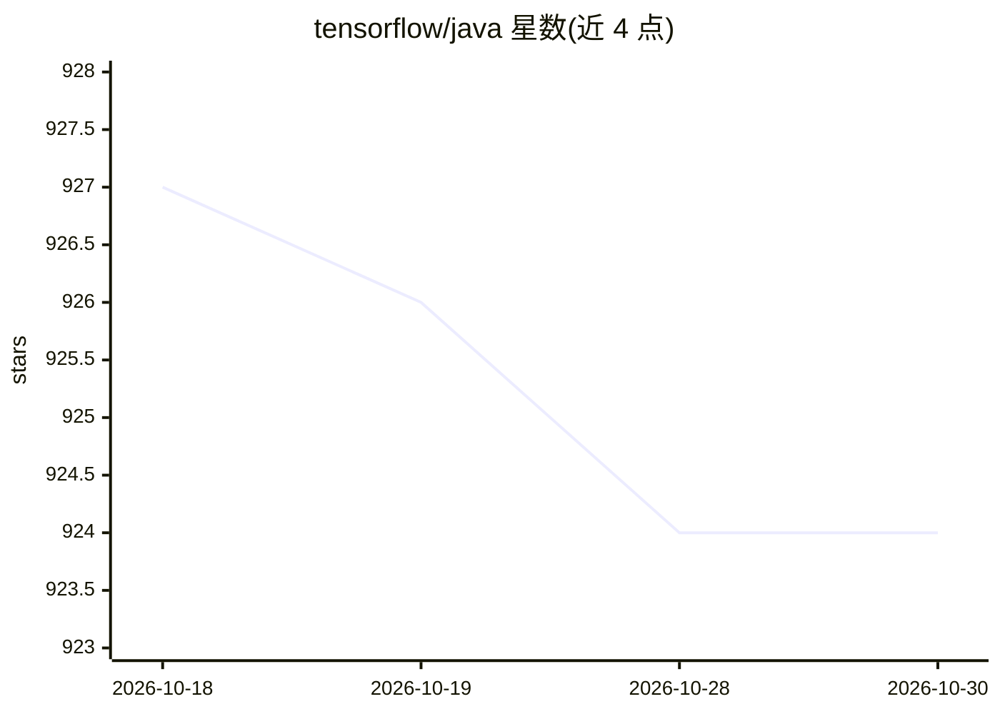

# tensorflow/java

⭐ 924 · Java · Apache-2.0 · 推送 2026-07-24 · [GitHub](https://github.com/tensorflow/java) · 组织维护

**在 JVM 上构建、训练与运行 TensorFlow 模型的 Java 绑定**

TensorFlow 官方 Java 语言绑定，独立于核心库发布，供 Java/Scala/Kotlin 等 JVM 语言项目接入 TensorFlow 原生库。仓库包含三部分：tensorflow-core（薄层核心绑定）、tensorflow-framework（构建与训练神经网络的主 API）、tensorflow-ndarray（可独立使用的 n 维数组 API）。通过 Maven/Gradle 依赖分发，按平台选择原生二进制（linux-x86_64/arm64、macosx-arm64 等），GPU 需自行安装 NVIDIA 驱动、CUDA 与 cuDNN；Windows 与 macOS x86_64 二进制自 1.2 版起不再分发。由 TensorFlow JVM SIG 维护。

## 筛选速览

| 维度 | 判定 | 备注 |
|---|---|---|
| AI 角色 | `ai-ecosystem` | LLM/agent 周边工具 |
| 许可风险 | `permissive` | Apache-2.0 |
| 部署形态 | `None` |  |
| 模型依赖 | — | README 未给出锁定关系 |
| 硬件要求 | — | 无带数字的原话,不猜 |
| 安装摩擦 | `medium` | 含编译或系统依赖之一 |
| 成熟度 | — | 结构信号不足 |

## 能力要点

- tensorflow-framework 提供构建与训练神经网络的 Java 主 API
- tensorflow-core 薄层绑定供上层框架直接访问原生库
- Maven/Gradle 依赖分发，支持按平台选择原生二进制（含 CUDA GPU 版）
- tensorflow-ndarray 可脱离 TensorFlow 独立使用

## 适用场景

- Java 企业项目中直接集成 TensorFlow 模型的构建与训练
- 为 TensorFlow 开发 JVM 语言之上的自有 API 或框架
- 在 Linux GPU 服务器上以 Java 部署 TensorFlow 应用

## 场景标签

`模型训练` `推理引擎` · 领域:训练与推理

## 证据(README 行号)

> L5: TensorFlow can run on any JVM for building, training and running machine learning models. It comes with
> L26: * `tensorflow-framework`

## 星数曲线

2026-10-18 927 → 2026-10-30 924（-3）

---
*卡片 v1 · prompt 1.4 · 生成 2026-10-21 · 置信度 high · 依据 README sha `41391e2fa4bf` · [字段定义](../../DATASET.md)*
