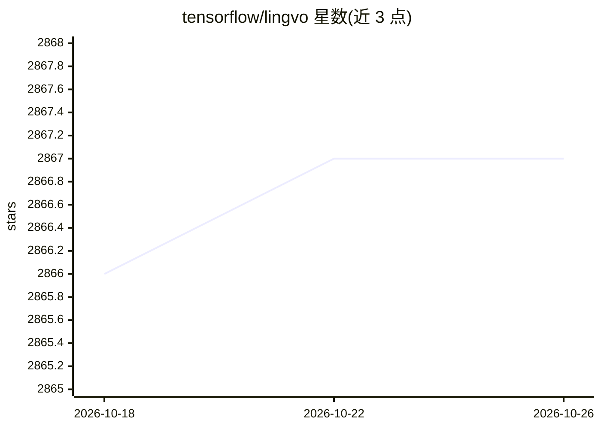

# tensorflow/lingvo

⭐ 2,867 · Python · Apache-2.0 · 推送 2026-10-24 · [GitHub](https://github.com/tensorflow/lingvo) · 组织维护

**TensorFlow 序列模型神经网络构建框架，面向研究与训练**

基于 TensorFlow 的神经网络构建框架，面向序列模型（seq2seq）的建模、训练与评测，覆盖语音识别、机器翻译、语言建模、图像与 3D 目标检测等任务的模型实现。提供 pip 安装与 bazel 源码构建两种途径，并附 Docker 配置；训练支持 CPU/GPU 与 CloudTPU 集群（如 GShard 万亿参数语言模型）。不承诺向后兼容，要求 Python 3.9+/3.11+ 与对应 TensorFlow 版本。附带论文可引用。

## 筛选速览

| 维度 | 判定 | 备注 |
|---|---|---|
| AI 角色 | `ai-ecosystem` | LLM/agent 周边工具 |
| 许可风险 | `permissive` | Apache-2.0 |
| 部署形态 | `self-host` | docker 或自建部署 |
| 模型依赖 | — | README 未给出锁定关系 |
| 硬件要求 | — | 无带数字的原话,不猜 |
| 安装摩擦 | `low` | 无编译、无系统依赖或容器化 |
| 成熟度 | — | 结构信号不足 |

## 能力要点

- 基于 TensorFlow 的序列模型框架，覆盖 ASR/MT/LM/图像/3D 检测任务
- 支持 GShard 万亿参数语言模型的 512 路模型并行训练
- 提供 pip、bazel 源码构建与 Docker 三种安装/运行方式
- 内置多种已发表论文对应的模型实现（LAS、Transformer、DeepFusion 等）

## 适用场景

- 研究者在 TensorFlow 上构建和训练序列到序列模型
- 在 GPU/CloudTPU 集群上训练大规模语言模型或机器翻译模型
- 复现论文中的 ASR、3D 目标检测等模型实现

## 场景标签

`模型训练` · 领域:训练与推理

## 证据(README 行号)

> L12: Lingvo is a framework for building neural networks in Tensorflow, particularly
> L58:  * Tensorflow 2.9 is now required.

## 星数曲线

2026-10-18 2,866 → 2026-10-26 2,867（+1）

---
*卡片 v1 · prompt 1.4 · 生成 2026-10-21 · 置信度 high · 依据 README sha `06429eee1ebc` · [字段定义](../../DATASET.md)*
