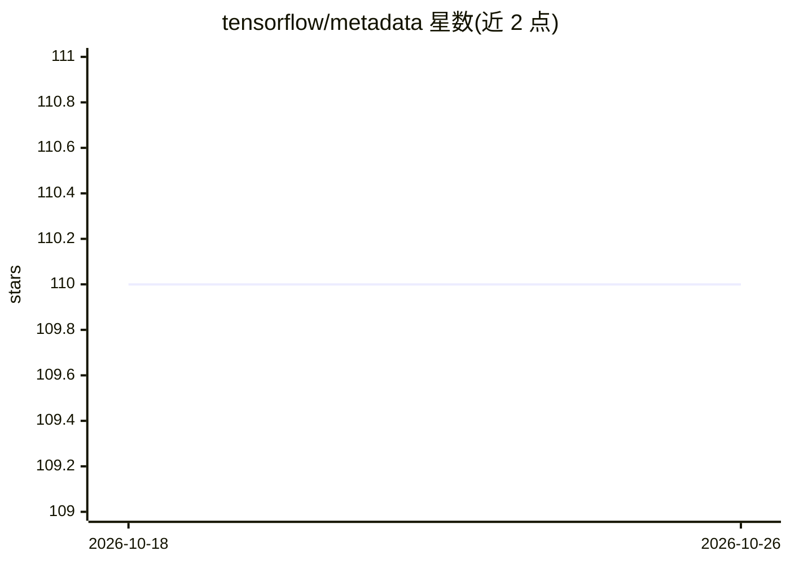

# tensorflow/metadata

⭐ 110 · Python · Apache-2.0 · 推送 2026-08-14 · [GitHub](https://github.com/tensorflow/metadata) · 组织维护

**TensorFlow 模型训练相关元数据的标准化表示库**

TensorFlow 官方组织下的 Python 库，为机器学习训练过程中使用的元数据提供标准化表示与序列化格式，包括：描述表格数据（如 tf.Examples）的 schema、数据集汇总统计、以及量化模型目标的问题陈述。元数据可手工生成或在输入数据分析中自动生成，供数据验证、探索与转换环节消费。以 Python 包形式发布于 PyPI，面向使用 TensorFlow 的开发者。

## 筛选速览

| 维度 | 判定 | 备注 |
|---|---|---|
| AI 角色 | `ai-ecosystem` | LLM/agent 周边工具 |
| 许可风险 | `permissive` | Apache-2.0 |
| 部署形态 | `library` | 以包/库形式分发 |
| 模型依赖 | — | README 未给出锁定关系 |
| 硬件要求 | — | 无带数字的原话,不猜 |
| 安装摩擦 | `low` | 无编译、无系统依赖或容器化 |
| 成熟度 | — | 结构信号不足 |

## 能力要点

- 提供表格数据 schema 的标准表示
- 数据集汇总统计的序列化格式
- 模型目标的问题陈述表示
- 支持数据验证、探索与转换消费元数据

## 适用场景

- 在 TensorFlow 训练流水线中传递标准化元数据
- 对 tf.Example 数据集做数据验证与探索
- 自动生成输入数据的统计元数据

## 场景标签

 · 领域:机器学习工具库/数据工程

## 证据(README 行号)

> L6: TensorFlow Metadata provides standard representations for metadata that are
> L15: The metadata may be produced by hand or automatically during input data

## 星数曲线

2026-10-18 110 → 2026-10-26 110（+0）

---
*卡片 v1 · prompt 1.4 · 生成 2026-10-23 · 置信度 high · 依据 README sha `1306a61c715f` · [字段定义](../../DATASET.md)*
