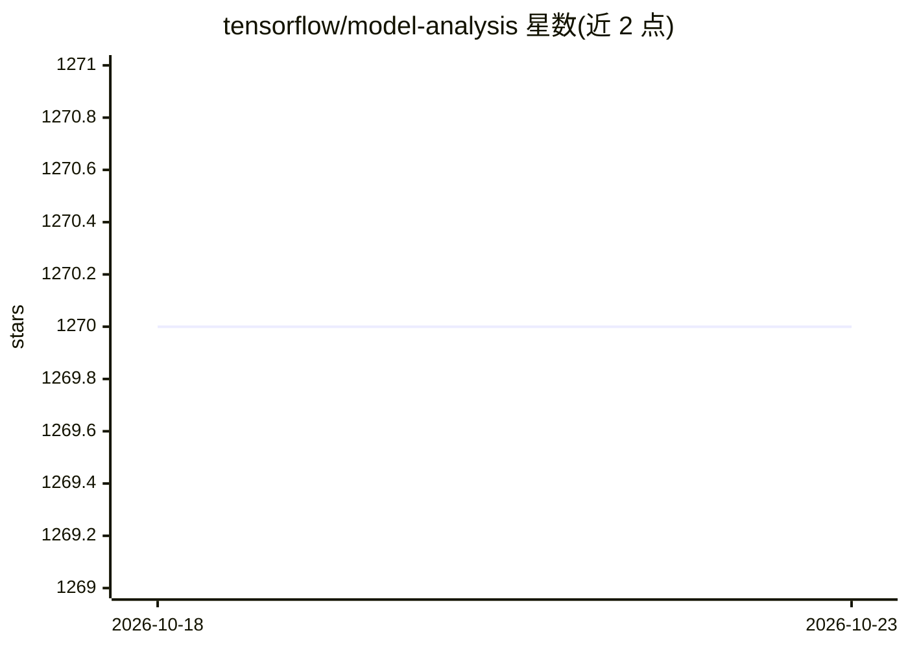

# tensorflow/model-analysis

⭐ 1,270 · Python · Apache-2.0 · 推送 2026-08-14 · [GitHub](https://github.com/tensorflow/model-analysis) · 组织维护

**评估 TensorFlow 模型的库：分布式计算分片指标并可视化**

TensorFlow Model Analysis (TFMA) 是用于评估 TensorFlow 模型的 Python 库：在大规模数据上以分布式方式（基于 Apache Beam）计算训练时定义的指标，支持按数据切片计算指标并在 Jupyter Notebook 中可视化（Slicing Metrics Browser）。要求已安装 TensorFlow、Apache Beam 与 Apache Arrow；通过 PyPI 提供，兼容 Kubeflow Pipelines 集成。1.0 前可能出现向后不兼容变更。

## 筛选速览

| 维度 | 判定 | 备注 |
|---|---|---|
| AI 角色 | `ai-ecosystem` | LLM/agent 周边工具 |
| 许可风险 | `permissive` | Apache-2.0 |
| 部署形态 | `library` | 以包/库形式分发 |
| 模型依赖 | — | README 未给出锁定关系 |
| 硬件要求 | — | 无带数字的原话,不猜 |
| 安装摩擦 | `low` | 无编译、无系统依赖或容器化 |
| 成熟度 | `idea` | |

## 能力要点

- 使用训练器中定义的指标在大规模数据上评估模型
- 基于 Apache Beam 的分布式计算（本地或 Dataflow 等 runner）
- 按数据切片计算指标并在 Jupyter 中可视化
- 提供与各依赖版本的兼容性对照表

## 适用场景

- 训练后大规模评估 TensorFlow 模型表现
- 按数据切片查看不同子群上的指标差异
- 在 Jupyter/Kubeflow Pipelines 中嵌入模型评估可视化

## 场景标签

 · 领域:机器学习基础设施/模型评估

## 证据(README 行号)

> L7: *TensorFlow Model Analysis* (TFMA) is a library for evaluating TensorFlow
> L8: models. It allows users to evaluate their models on large amounts of data in a

## 星数曲线

2026-10-18 1,270 → 2026-10-23 1,270（+0）

---
*卡片 v1 · prompt 1.4 · 生成 2026-10-21 · 置信度 high · 依据 README sha `ec5f91d4db06` · [字段定义](../../DATASET.md)*
