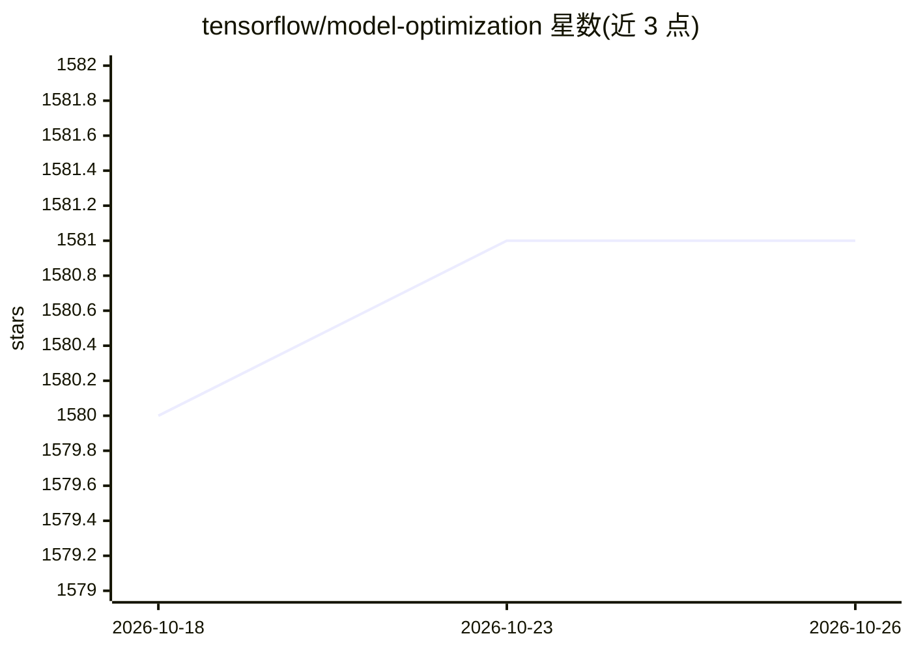

# tensorflow/model-optimization

⭐ 1,581 · Python · Apache-2.0 · 推送 2026-10-24 · [GitHub](https://github.com/tensorflow/model-optimization) · [官网](https://www.tensorflow.org/model_optimization) · 组织维护

**面向 Keras/TensorFlow 的模型部署优化工具包（量化与剪枝）**

TensorFlow 官方维护的模型优化工具套件，提供面向新手与高级用户的稳定 Python API，支持量化（quantization）、稀疏权重剪枝（pruning）与聚类（clustering）等子包，用于优化机器学习模型以利于部署与执行，并针对 Keras 提供专用 API。安装说明与教程、API 文档托管于 tensorflow.org。量化子包由 TensorFlow Model Optimization 团队维护，clustering 子包由 Arm ML Tooling 维护。

## 筛选速览

| 维度 | 判定 | 备注 |
|---|---|---|
| AI 角色 | `ai-ecosystem` | LLM/agent 周边工具 |
| 许可风险 | `permissive` | Apache-2.0 |
| 部署形态 | `None` |  |
| 模型依赖 | — | README 未给出锁定关系 |
| 硬件要求 | — | 无带数字的原话,不猜 |
| 安装摩擦 | `low` | 无编译、无系统依赖或容器化 |
| 成熟度 | — | 结构信号不足 |

## 能力要点

- 提供稳定的 Python API
- 支持量化、剪枝（稀疏权重）与聚类技术
- 针对 Keras 构建专用 API

## 适用场景

- 训练后对 Keras/TensorFlow 模型做量化以适配部署
- 通过剪枝获得稀疏权重模型
- 查阅模型优化的教程与路线图

## 场景标签

`模型量化` · 领域:训练与推理

## 证据(README 行号)

> L3: The **TensorFlow Model Optimization Toolkit** is a suite of tools that users,
> L7: Supported techniques include quantization and pruning for sparse weights.
> L8: There are APIs built specifically for Keras.

## 星数曲线

2026-10-18 1,580 → 2026-10-26 1,581（+1）

---
*卡片 v1 · prompt 1.4 · 生成 2026-10-21 · 置信度 high · 依据 README sha `65cbfe4cb530` · [字段定义](../../DATASET.md)*
