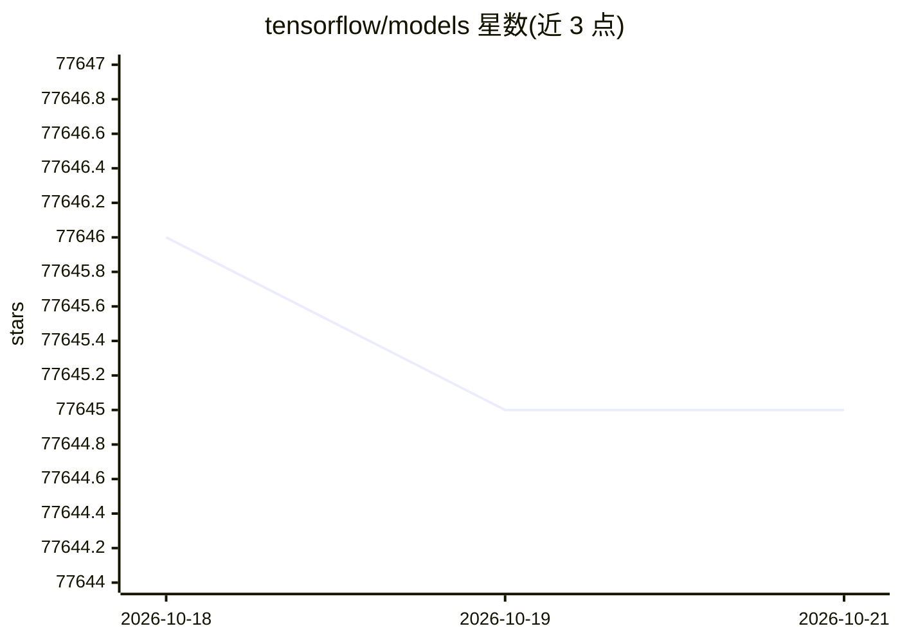

# tensorflow/models

⭐ 77,645 · Python · NOASSERTION · 推送 2026-10-13 · [GitHub](https://github.com/tensorflow/models) · 组织维护

**TensorFlow 用户的 SOTA 模型与建模方案实现仓库**

TensorFlow Model Garden 仓库，包含四部分：official（官方维护、基于 TF2 高层 API 的 SOTA 模型示例实现）、research（研究者维护的 TF1/TF2 研究模型）、community（社区模型仓库清单）与 orbit（自定义训练循环库，集成 tf.distribute，支持 CPU/GPU/TPU）。面向用 TensorFlow 做研究与产品开发的用户，提供训练日志（TensorBoard.dev），可通过 pip 包或克隆源码安装。

## 筛选速览

| 维度 | 判定 | 备注 |
|---|---|---|
| AI 角色 | `ai-ecosystem` | LLM/agent 周边工具 |
| 许可风险 | `none` | NOASSERTION |
| 部署形态 | `library` | 以包/库形式分发 |
| 模型依赖 | — | README 未给出锁定关系 |
| 硬件要求 | — | 无带数字的原话,不猜 |
| 安装摩擦 | `low` | 无编译、无系统依赖或容器化 |
| 成熟度 | — | 结构信号不足 |

## 动量与使用信号

- 维护:`active` — 距上次 push 5.1 天,年发版 1,361 位贡献者
- 涨星:近 1 天 **+2**(自 20261016 起算)
- 安装:pypi 包 `tf-models-official` 月下载 16,769
- 平台:WINDOWS · 协议:—

## 能力要点

- official/research/community/orbit 四类模型集合
- orbit 训练循环库支持 CPU、GPU 与 TPU
- 提供 tf-models-official 稳定版与 tf-models-nightly 每日构建包
- 部分模型提供 TensorBoard.dev 训练日志

## 适用场景

- 查找 TensorFlow 2 官方维护的 SOTA 模型实现
- 为研究复现模型训练并参考官方建模实践
- 基于 orbit 库编写自定义分布式训练循环

## 场景标签

 · 领域:机器学习/模型实现

## 证据(README 行号)

> L7: implementations of state-of-the-art (SOTA) models and modeling solutions for
> L9: TensorFlow users can take full advantage of TensorFlow for their research and
> L21: |orbit|• A flexible and lightweight library that users can easily use or fork when writing customized training loop

## 星数曲线

2026-10-18 77,646 → 2026-10-21 77,645（-1）

---
*卡片 v1 · prompt 1.4 · 生成 2026-10-18 · 置信度 high · 依据 README sha `7b9872d74f8a` · [字段定义](../../DATASET.md)*
