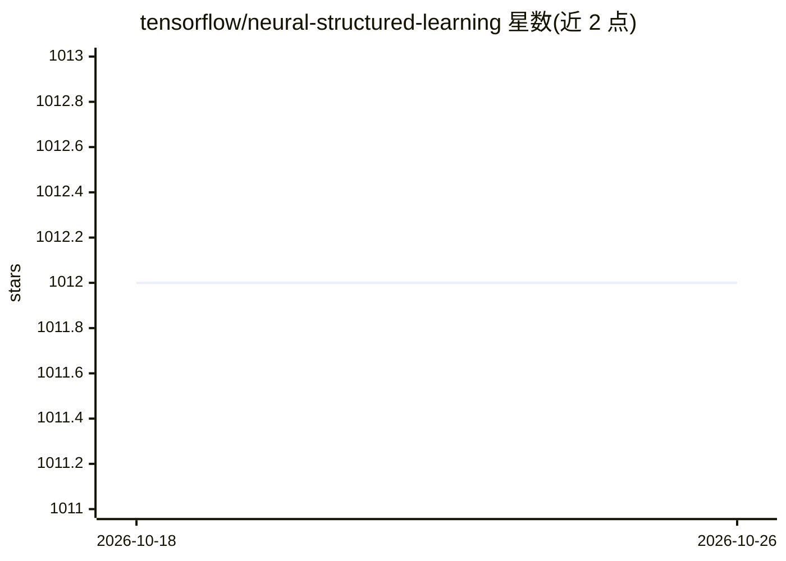

# tensorflow/neural-structured-learning

⭐ 1,012 · Python · Apache-2.0 · 推送 2026-10-05 · [GitHub](https://github.com/tensorflow/neural-structured-learning) · [官网](https://www.tensorflow.org/neural_structured_learning) · 组织维护

**给开发者的 TensorFlow 结构化信号训练框架（图学习+对抗学习）**

Neural Structured Learning（NSL）是 TensorFlow 下的训练框架，供开发者用结构化信号（显式图结构或对抗扰动隐式结构）训练神经网络，覆盖监督与半监督学习场景，标注数据少时可利用无标注样本。提供 Keras API、TF 底层算子与函数、以及构建图和图输入的工具；可训练前馈、卷积、循环等各类网络，结构化信号仅在训练阶段引入，不影响推理流程。要求 TensorFlow 1.15 以上（v2.1 除外），以 pip 包分发，附 Colab 教程与示例。

## 筛选速览

| 维度 | 判定 | 备注 |
|---|---|---|
| AI 角色 | `ai-ecosystem` | LLM/agent 周边工具 |
| 许可风险 | `permissive` | Apache-2.0 |
| 部署形态 | `library` | 以包/库形式分发 |
| 模型依赖 | — | README 未给出锁定关系 |
| 硬件要求 | — | 无带数字的原话,不猜 |
| 安装摩擦 | `low` | 无编译、无系统依赖或容器化 |
| 成熟度 | — | 结构信号不足 |

## 能力要点

- Keras API 支持图结构与对抗扰动两种训练方式
- 提供 TF 底层算子及建图/构造图输入的工具
- 支持监督与半监督学习，可训练任意类型的神经网络
- 结构化信号仅用于训练，推理流程不变

## 适用场景

- 标注数据不足时利用无标注样本与图关系做半监督训练
- 通过对抗扰动提升模型对恶意攻击的鲁棒性
- 用自然图或合成图训练分类/嵌入模型

## 场景标签

 · 领域:机器学习框架/图学习

## 证据(README 行号)

> L17: [3]. The NSL framework in TensorFlow provides the following easy-to-use APIs and
> L20: * **Keras APIs** to enable training with graphs (explicit structure) and
> L23: * **TF ops and functions** to enable training with structure when using

## 星数曲线

2026-10-18 1,012 → 2026-10-26 1,012（+0）

---
*卡片 v1 · prompt 1.4 · 生成 2026-10-21 · 置信度 high · 依据 README sha `3b56b5a5fbc1` · [字段定义](../../DATASET.md)*
