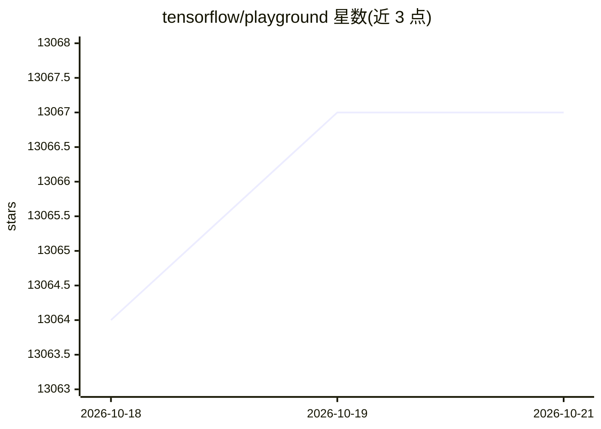

# tensorflow/playground

⭐ 13,067 · TypeScript · Apache-2.0 · 推送 2026-06-10 · [GitHub](https://github.com/tensorflow/playground) · [官网](http://playground.tensorflow.org) · 组织维护

**神经网络交互式可视化教学网页，可在线调节网络实验**

用 TypeScript 与 d3.js 编写的神经网络交互式可视化 Web 应用：用户可在浏览器中搭建、调节小型神经网络并观察其训练过程。面向学习与教学场景，运行方式为 npm 安装依赖、编译并本地起 http 服务；开发模式下支持文件变更自动重新编译。README 声明这不是官方 Google 产品。

## 筛选速览

| 维度 | 判定 | 备注 |
|---|---|---|
| AI 角色 | `ai-native` | 本体是模型或模型工具 |
| 许可风险 | `permissive` | Apache-2.0 |
| 部署形态 | `library` | 以包/库形式分发 |
| 模型依赖 | — | README 未给出锁定关系 |
| 硬件要求 | — | 无带数字的原话,不猜 |
| 安装摩擦 | `low` | 无编译、无系统依赖或容器化 |
| 成熟度 | — | 结构信号不足 |

## 能力要点

- 基于 TypeScript 与 d3.js 的神经网络交互可视化
- 支持本地运行（npm run serve）与开发热刷新（serve-watch）
- 编译产物输出到 dist 目录，可部署到 gh-pages

## 适用场景

- 直观观察神经网络结构与训练过程，用于学习入门
- 教学中演示调参对训练效果的影响

## 场景标签

`教程课程` · 领域:学习与行业

## 证据(README 行号)

> L3: Deep playground is an interactive visualization of neural networks, written in
> L4: TypeScript using d3.js. We use GitHub issues for tracking new requests and bugs.

## 星数曲线

2026-10-18 13,064 → 2026-10-21 13,067（+3）

---
*卡片 v1 · prompt 1.4 · 生成 2026-10-20 · 置信度 high · 依据 README sha `1c5b18e25bc4` · [字段定义](../../DATASET.md)*
