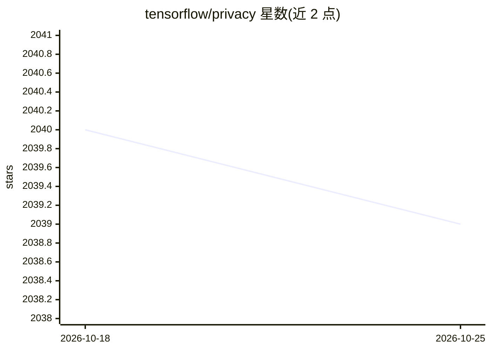

# tensorflow/privacy

⭐ 2,039 · Python · Apache-2.0 · 推送 2026-10-22 · [GitHub](https://github.com/tensorflow/privacy) · 组织维护

**TensorFlow 差分隐私训练库：DP 优化器与隐私保证分析工具**

TensorFlow Privacy 是 Google 维护的 Python 库，提供差分隐私版 TensorFlow 优化器，用于在训练机器学习模型时保护训练数据隐私；附带教程与分析工具计算所提供的隐私保证。自 0.9.0 起拆分为两个 PyPI 包：tensorflow-privacy（DP 模型训练）与 tensorflow-empirical-privacy（经验隐私测试）。支持 TensorFlow 2.x 的 Keras 版 DP 优化器（需 TF 2.4+），并含论文复现代码目录；教程不属于 API，可能随时变更。

## 筛选速览

| 维度 | 判定 | 备注 |
|---|---|---|
| AI 角色 | `ai-ecosystem` | LLM/agent 周边工具 |
| 许可风险 | `permissive` | Apache-2.0 |
| 部署形态 | `library` | 以包/库形式分发 |
| 模型依赖 | — | README 未给出锁定关系 |
| 硬件要求 | — | 无带数字的原话,不猜 |
| 安装摩擦 | `low` | 无编译、无系统依赖或容器化 |
| 成熟度 | — | 结构信号不足 |

## 能力要点

- 差分隐私版 TensorFlow 优化器（如 DP SGD/Adam 的包装）
- 计算隐私保证的分析工具
- 对仅含 Dense/Embedding 层的 Keras 模型提供高效逐样本梯度裁剪实现
- tutorials/ 教程目录与 research/ 论文复现代码目录

## 适用场景

- 用差分隐私方法训练 TensorFlow 模型以保护训练数据
- 测量与验证 DP 训练的隐私保证（epsilon 预算）
- 复现隐私机器学习相关论文的结果

## 场景标签

`模型训练` · 领域:训练与推理

## 证据(README 行号)

> L4: library that includes implementations of TensorFlow optimizers for training
> L6: tutorials and analysis tools for computing the privacy guarantees provided.

## 星数曲线

2026-10-18 2,040 → 2026-10-25 2,039（-1）

---
*卡片 v1 · prompt 1.4 · 生成 2026-10-21 · 置信度 high · 依据 README sha `41e89803ead8` · [字段定义](../../DATASET.md)*
