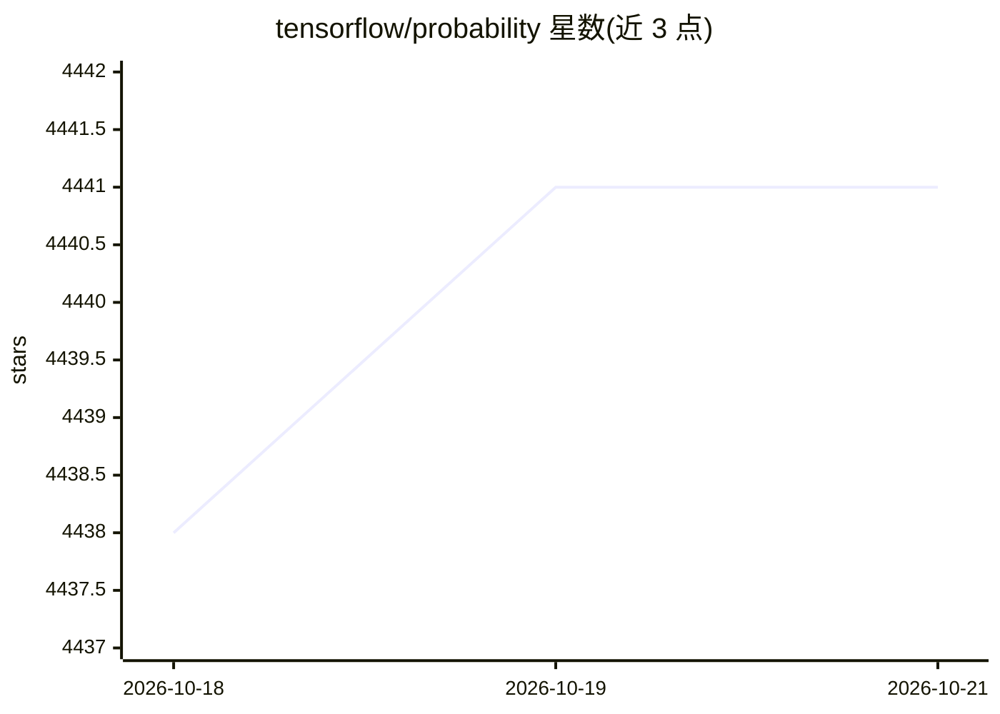

# tensorflow/probability

⭐ 4,441 · Jupyter Notebook · Apache-2.0 · 推送 2026-10-16 · [GitHub](https://github.com/tensorflow/probability) · [官网](https://www.tensorflow.org/probability/) · 组织维护

**TensorFlow 生态的概率推理与统计分析库**

TensorFlow Probability (TFP) 是一个用于概率推理与统计分析的 Python 库，面向进行贝叶斯建模、概率编程的机器学习开发者与科研人员。它以四层结构组织：统计构件（Distributions/Bijectors）、模型构建（JointDistributions/概率层）、概率推断（MCMC、变分推断、随机优化器）。支持 GPU 硬件加速与分布式计算，提供纯 JAX substrate。通过 pip 安装稳定版或 nightly 版，TensorFlow 需显式安装；源码构建依赖 Bazel。接口可能随时变化，开发活跃。

## 筛选速览

| 维度 | 判定 | 备注 |
|---|---|---|
| AI 角色 | `ai-native` | 本体是模型或模型工具 |
| 许可风险 | `permissive` | Apache-2.0 |
| 部署形态 | `library` | 以包/库形式分发 |
| 模型依赖 | — | README 未给出锁定关系 |
| 硬件要求 | `cpu-ok` | |
| 安装摩擦 | `low` | 无编译、无系统依赖或容器化 |
| 成熟度 | `idea` | |

## 能力要点

- Distributions/Bijectors 统计构件，支持 batch 与 broadcasting 语义
- MCMC（HMC、随机游走 Metropolis-Hastings）与变分推断算法
- 神经网络层与优化器的不确定性扩展（概率层、贝叶斯神经网络）
- 支持纯 JAX substrate 与 GPU/分布式加速

## 适用场景

- 构建贝叶斯神经网络、贝叶斯 logistic 回归等不确定性模型
- 用 MCMC 或变分推断做概率推断
- 做层次线性模型、概率 PCA、高斯混合聚类等统计分析

## 场景标签

 · 领域:机器学习/概率编程

## 证据(README 行号)

> L3: TensorFlow Probability is a library for probabilistic reasoning and statistical
> L51: * Markov chain Monte Carlo (`tfp.mcmc`):
> L56: * Variational Inference (`tfp.vi`):

## 星数曲线

2026-10-18 4,438 → 2026-10-21 4,441（+3）

---
*卡片 v1 · prompt 1.4 · 生成 2026-10-21 · 置信度 high · 依据 README sha `62e9ca7a4ba4` · [字段定义](../../DATASET.md)*
