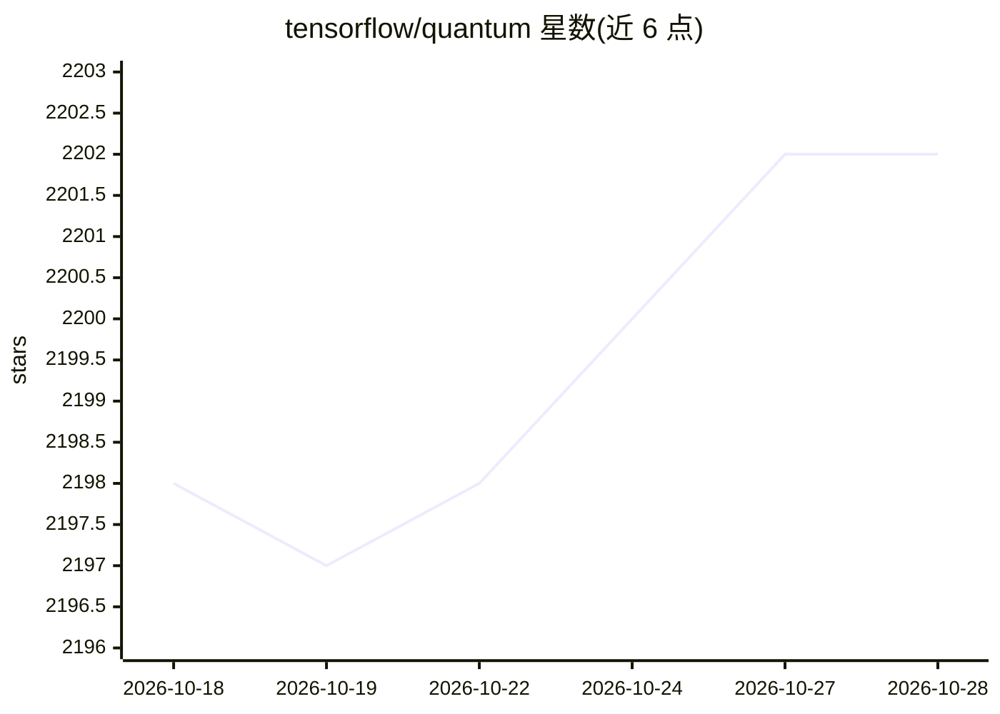

# tensorflow/quantum

⭐ 2,201 · Python · Apache-2.0 · 推送 2026-10-23 · [GitHub](https://github.com/tensorflow/quantum) · [官网](https://www.tensorflow.org/quantum) · 组织维护

**混合量子-经典机器学习 Python 框架，面向量子算法研究者**

TensorFlow Quantum (TFQ) 是一个开源 Python 框架，用于构建混合量子-经典机器学习模型，面向量子算法与机器学习研究者。机制上：集成 Cirq 编写量子电路定义、集成 qsim 运行电路模拟、以 Keras 提供量子机器学习高层抽象，并以 C++ TensorFlow Ops 实现算子，支持参数移位、伴随法等量子电路梯度计算与自动微分。构建与测试环境为 Linux（Python 3.10–3.12、TensorFlow 2.19.1、Cirq 1.5.0 等），安装方式见官方文档，PyPI 有发布。项目声明非 Google 官方支持产品。

## 筛选速览

| 维度 | 判定 | 备注 |
|---|---|---|
| AI 角色 | `ai-ecosystem` | LLM/agent 周边工具 |
| 许可风险 | `permissive` | Apache-2.0 |
| 部署形态 | `library` | 以包/库形式分发 |
| 模型依赖 | — | README 未给出锁定关系 |
| 硬件要求 | — | 无带数字的原话,不猜 |
| 安装摩擦 | `low` | 无编译、无系统依赖或容器化 |
| 成熟度 | — | 结构信号不足 |

## 能力要点

- 集成 Cirq 编写量子电路、qsim 运行电路模拟
- 以 Keras 提供量子机器学习高层抽象
- 量子电路自动微分系统，含参数移位与伴随法
- 算子以 C++ TensorFlow Ops 实现，纳入 TF 计算图

## 适用场景

- 构建与训练混合量子-经典机器学习模型
- 需要快速模拟大量中等规模量子电路的研究问题
- 借助 TensorFlow 工具链做量子数据建模

## 场景标签

 · 领域:量子计算/机器学习框架

## 证据(README 行号)

> L22: TensorFlow Quantum (TFQ) is a Python
> L23: framework for hybrid quantum-classical machine learning focused on modeling
> L24: quantum data. It provides users with the tools they need to interleave quantum

## 星数曲线

2026-10-18 2,198 → 2026-10-28 2,202（+4）

---
*卡片 v1 · prompt 1.4 · 生成 2026-10-21 · 置信度 high · 依据 README sha `90ec27bf702a` · [字段定义](../../DATASET.md)*
