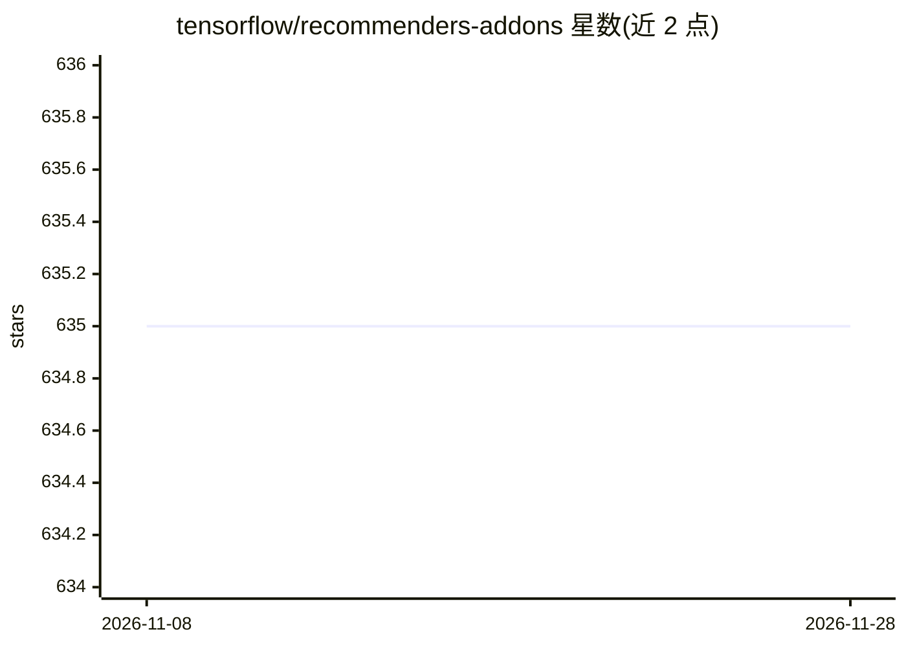

# tensorflow/recommenders-addons

⭐ 635 · Cuda · Apache-2.0 · 推送 2026-11-04 · [GitHub](https://github.com/tensorflow/recommenders-addons) · 组织维护

**为 TensorFlow 引入动态嵌入技术的推荐系统扩展库**

TensorFlow Recommenders Addons（TFRA）由 SIG Recommenders 维护，在 TensorFlow 中引入可训练的 Key-Value 动态嵌入结构，用于搜索、推荐、广告场景的大规模模型训练与推理。兼容原生 TensorFlow 优化器、CheckPoint 与 SavedModel，支持 GPU 训练推理、TF Serving 与 Triton 部署，存储后端可选 cuckoohash_map（CPU）、HierarchicalKV（GPU）与 Redis，并支持基于 Horovod 的半同步训练。发布包与 TensorFlow 版本严格绑定，Apple silicon 版存在 float16、Horovod 等功能限制。

## 筛选速览

| 维度 | 判定 | 备注 |
|---|---|---|
| AI 角色 | `ai-ecosystem` | LLM/agent 周边工具 |
| 许可风险 | `permissive` | Apache-2.0 |
| 部署形态 | `self-host` | docker 或自建部署 |
| 模型依赖 | — | README 未给出锁定关系 |
| 硬件要求 | — | 无带数字的原话,不猜 |
| 安装摩擦 | `low` | 无编译、无系统依赖或容器化 |
| 成熟度 | — | 结构信号不足 |

## 能力要点

- 动态嵌入（Key-Value）变量在 TensorFlow 中可训练
- 支持 TF Serving 与 Triton Inference Server 推理
- 可扩展存储后端：cuckoohash_map / HierarchicalKV / Redis
- 基于 Horovod 的稠密同步 + 稀疏异步半同步训练

## 适用场景

- 在 TensorFlow 中训练大规模搜索/推荐/广告模型
- 用动态嵌入避免静态哈希冲突
- 通过 TF Serving 或 Triton 部署含自定义算子的推荐模型

## 场景标签

`推荐系统` · 领域:学习与行业

## 证据(README 行号)

> L7: TensorFlow Recommenders Addons(TFRA) are a collection of projects related to large-scale recommendation systems
> L10: makes building, evaluating, and serving sophisticated recommenders models easy.

## 星数曲线

2026-11-08 635 → 2026-11-28 635（+0）

---
*卡片 v1 · prompt 1.4 · 生成 2026-11-17 · 置信度 mid · 依据 README sha `93d2b18b7bc0` · [字段定义](../../DATASET.md)*
