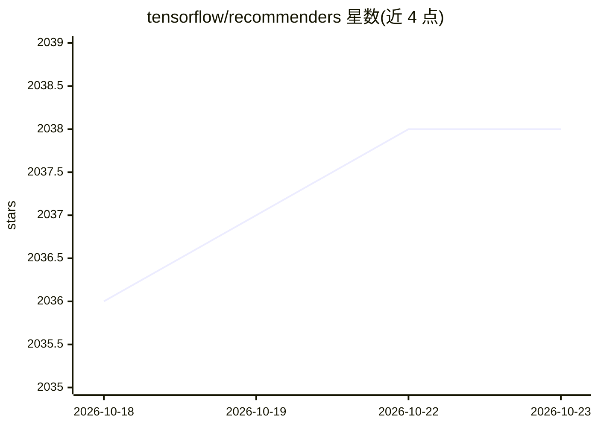

# tensorflow/recommenders

⭐ 2,038 · Python · Apache-2.0 · 推送 2026-10-06 · [GitHub](https://github.com/tensorflow/recommenders) · 组织维护

**基于 TensorFlow 的推荐系统模型构建库**

TensorFlow Recommenders 是构建推荐系统模型的 TensorFlow 库，覆盖数据准备、模型构建、训练、评估与部署的完整流程。基于 Keras 构建，支持从简单到复杂的模型结构。需先安装 TensorFlow 2.x，通过 pip 从 PyPI 安装，提供教程、API 文档与 Colab 快速上手示例（Movielens 100K 矩阵分解模型）。

## 筛选速览

| 维度 | 判定 | 备注 |
|---|---|---|
| AI 角色 | `ai-ecosystem` | LLM/agent 周边工具 |
| 许可风险 | `permissive` | Apache-2.0 |
| 部署形态 | `library` | 以包/库形式分发 |
| 模型依赖 | — | README 未给出锁定关系 |
| 硬件要求 | — | 无带数字的原话,不猜 |
| 安装摩擦 | `low` | 无编译、无系统依赖或容器化 |
| 成熟度 | — | 结构信号不足 |

## 能力要点

- 覆盖推荐系统全流程：数据准备、建模、训练、评估、部署
- 基于 Keras 构建，支持构建复杂模型
- 提供教程、API 参考与 Colab 快速开始示例

## 适用场景

- 在 TensorFlow 技术栈中搭建推荐系统模型
- 学习推荐系统建模流程（含 Movielens 示例）
- 将训练好的推荐模型部署到生产环境

## 场景标签

 · 领域:推荐系统/机器学习库

## 证据(README 行号)

> L8: TensorFlow Recommenders is a library for building recommender system models
> L11: It helps with the full workflow of building a recommender system: data

## 星数曲线

2026-10-18 2,036 → 2026-10-23 2,038（+2）

---
*卡片 v1 · prompt 1.4 · 生成 2026-10-21 · 置信度 high · 依据 README sha `cc33b433d3b0` · [字段定义](../../DATASET.md)*
